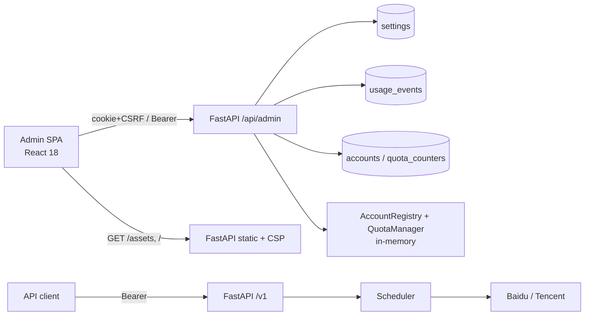

# Design

## Context

现状（均已用代码/命令核验，锚见括号）：

- 管理 API 只有 Bearer token：登录换签名 token，`require_admin` 从 `Authorization` 取 token（`backend/app/api/deps.py:41-60`）；20 个管理路由中 19 个非登录路由全部经该依赖（`backend/app/api/admin.py`）。
- 没有前端工程、没有静态托管：`frontend/` 不存在；`backend/app/main.py:195-200` 只挂公共/管理路由；`Dockerfile` 没有 Node 阶段。`.gitignore:18-20` 已预留 `node_modules/` 与 `frontend/dist/`。
- 没有 settings 表：`backend/app/models.py` 无该模型，`backend/alembic/versions/` 只有 `0001_initial.py`；缓存 TTL/容量与请求 deadline 在启动时固化（`backend/app/core/cache.py:13-17`、`backend/app/core/scheduler.py:56-73`、`backend/app/main.py:84-95`）。
- 数据面缺口：`_account_out` 无已用配额（`backend/app/api/admin.py:93-117`）；`usage_summary` 只有整段聚合行、无时间序列（`:495-535`）；`list_logs` 无时间过滤与总数（`:536-575`）。
- 安全面缺口：响应头只有 `X-Request-ID`（`backend/app/main.py:119`）；`docs/tech-selection.md:489` 要求面板 CSP、`X-Content-Type-Options`、`Referrer-Policy`。
- 构建环境：npm 官方源不可达、`registry.npmmirror.com` 可达；`node:22-bookworm-slim` 已成功拉取（digest `sha256:4b150b48…`）。Docker 配置了 registry mirror。
- 技术栈与视觉方向：`docs/tech-selection.md:15`、`:111` 定 React + Vite + Tailwind + shadcn/ui + Recharts；人 2026-11-04 拍板浅色单主题、深墨蓝、极简高级。

动机与范围见 `proposal.md`；决策全文与砍掉的候选见 `decision-memo.md`。

## 利益相关方与外部依赖

- **使用者 / 验收人**：管理员（决策与验收，权力级别：决策）；团队成员只通过已有网关 Key 调用公共 API，不直接使用面板。
- **无跨团队 sign-off**：本 change 不改变公共 API 契约、不改厂商适配器、不改配额语义；不需要外部团队配合。
- **构建期外部依赖**：npm registry（本机经 npmmirror，镜像构建经 `NPM_REGISTRY`）与 Docker registry（Node/Python 基础镜像）。运维需知晓镜像构建时间会增加一个前端阶段。
- **运行期外部依赖**：无新增第三方服务；字体自托管，前端不接统计/CDN；OCR 厂商调用沿用现状。

## Goals / Non-Goals

**Goals:**

- 管理员在浏览器完成登录、会话续用、登出；写操作受 CSRF 保护，Bearer 路径不受影响。
- 七个路由可用：登录、总览、账号、成员与 Key、用量、日志、设置。
- 设置项持久化、可校验、保存后即时生效；缓存参数变更的行为可解释。
- 数据端点支持总览指标、日序列、日志时间过滤/总数、账号周期用量。
- 构建产物由 FastAPI 同源托管并进入镜像；安全响应头齐备。
- 视觉按已拍板 token 与结构落地，关键页有加载/空/错误三态。

**Non-Goals（设计层）:**

- 不做 SSR / RSC / 同构渲染；SPA 静态托管。
- 不做全局状态库；远端数据只用 React Query，UI 状态留在 URL 或组件内。
- 不做服务端 CSV、服务端图表渲染。
- 不做多语言框架；v1 文案中文，日期/数字用 `Intl`。
- 不做深色主题、WebSocket/SSE、离线缓存、账号/成员列表分页（数据量假设见下）。
- 不做管理端多角色/成员登录；只有单一 admin。
- 不做 aliyun/huawei 账号表单（适配器未交付）。

## Decisions

### D-A1 管理端鉴权：cookie + CSRF 双轨，Bearer 保留

**方案**

- 登录响应同时返回 `token`、`expires_in`、`csrf_token`，并设置两个 cookie：
  - `ocr_admin_session`：值为现有 `create_admin_token` 签名 token；`Path=/; HttpOnly; SameSite=Lax; Max-Age=<session_ttl_seconds>`；HTTPS 时加 `Secure`。
  - `ocr_csrf`：32 字节 `secrets.token_urlsafe`；`Path=/; SameSite=Lax; Max-Age=<session_ttl_seconds>`；**不**加 `HttpOnly`（前端要读）。
- `require_admin` 先看 `Authorization: Bearer`；没有再看 `ocr_admin_session` cookie。Bearer 存在但无效时直接 401，不回退 cookie（避免陈旧 Authorization 头把浏览器会话带进不确定状态）；两者都无/无效 → 401。
- 认证来源为 cookie 且方法属于 `POST/PUT/PATCH/DELETE` 时，校验 `X-CSRF-Token` 与 `ocr_csrf` cookie 常量时间相等；缺失或不符 → 403 `FORBIDDEN`。Bearer 来源豁免 CSRF。
- `GET /api/admin/me` 返回 `{"username":"admin","csrf_token":"…"}`；若 cookie 会话存在但 `ocr_csrf` 缺失，则补发 CSRF cookie（GET 只补 cookie，不改变业务状态）。
- `POST /api/admin/logout`：经 `require_admin`；清空两个 cookie（`Max-Age=0`），返回 204。无服务端会话表，Bearer token 仍按原语义到期失效。
- `Secure` 判定：`request.url.scheme == "https"`，或 `TRUST_PROXY_HEADERS=true` 且 `X-Forwarded-Proto` 首跳为 `https`。
- CSRF 失败与未登录都走现有错误 envelope：`{"request_id": "...", "error": {"code": "...", "message": "..."}}`。

**为什么不是别的**

- Bearer + localStorage：12h token 可被任意 XSS 读取；且偏离 `docs/tech-selection.md:482-483`。
- 服务端 CSRF 存储（session 表）：双提交不需要服务端状态；单实例下增加清理负担，无收益。
- 只做 cookie 不做 Bearer：会破坏 `/docs` 与 curl 工作流；MVP D4 明确要「双轨」。

**代价**：引入 CSRF 失败面；cookie 在 HTTP 本地下不带 `Secure`（README 说明公网必须 HTTPS）。

### D-A2 运行时设置：新表 + 进程内 RuntimeSettings

**方案**

- 新表 `settings(key TEXT PK, value TEXT NOT NULL, updated_at DATETIME NOT NULL)`；`value` 存 JSON 编码（bool/int），读取时校验类型与范围。
- 启动顺序：迁移完成后加载表 → 与 env 默认值合并 → 构造 `RuntimeSettings` → 用其构造 `ResultCache`/`Scheduler`；非法存量值忽略并记 warning，不阻塞启动。
- `RuntimeSettings` 是普通 dataclass，字段与 env 同名；单事件循环内整体替换字段，读写无锁。设置更新路径不含 `await` 中断，DB 提交完成后再应用运行时；并发请求只会看到旧值或新值，不会看到半更新状态。不引入线程/进程共享状态。
- 缓存重建（`reconfigure`）在写请求的同步段内完成；正在路上的 OCR 请求可能已持有旧 cache 引用，下一次请求使用新 cache，属于可接受的一次性过渡。
- `Scheduler` 改为每次 `recognize` 读取 `runtime_settings.request_deadline_ms`（不再在构造时固化）。
- `ResultCache` 增加 `reconfigure(enabled, ttl_seconds, max_entries) -> bool`：参数不变返回 False；变化则重建 `TTLCache`（清空旧条目）并返回 True。
- `AccountCreate.timeout_ms` 默认从 `8000` 改为 `None`；`create_account` 用 `payload.timeout_ms or runtime.default_timeout_ms`。PATCH 语义不变。
- `PUT /api/admin/settings` 接受部分字段；先全量校验，再单事务 upsert；提交成功后才应用运行时；返回 `cache_cleared` 标志。任何校验失败 → 400，DB 与运行时都不变。请求模型 `extra="forbid"`，未知键也返回 400（防拼写错误被静默忽略）。
- 可编辑项：`cache_enabled`（bool）、`cache_ttl_seconds`（60–86400）、`cache_max_entries`（10–10000）、`request_deadline_ms`（1000–60000）、`default_timeout_ms`（1000–60000）。
- 只读项（GET 返回）：`api_auth_enabled`（恒 true）、`version`、`max_upload_bytes`、`max_image_pixels`、`max_concurrent_requests`、`session_ttl_seconds`、`frontend_built`。

**为什么不是别的**

- 只用 env：设置页无法即时生效，M3 的「设置面板」退化。
- 每次请求查 DB：热路径多一次 IO；单实例下进程内对象足够。
- 缓存 TTL 只对新条目生效：`cachetools.TTLCache` 的 ttl 是 cache 级，无法按条目设置；自研 TTL 结构成本高。

**代价**：保存缓存参数会清空缓存（人已知晓并接受）；多实例下设置不跨进程同步（v1 单实例约束）。

### D-A3 数据面：新增总览/序列，扩展查询

**方案**

- `GET /api/admin/overview` 一次返回今日指标、厂商可用账号、账号配额用量、最近 10 条错误、缓存状态；今日窗口固定 `Asia/Shanghai` 00:00 到当前。
- `GET /api/admin/usage/series` 返回按本地日分桶的序列；缺日补零；默认 7 天，最大 90 天；支持 `user_id/provider/account_id` 过滤。
- `GET /api/admin/usage/summary` 增加 `avg_latency_ms` 与同样的过滤参数；行按 key 升序；每行增加 `label`（成员名/账号名/厂商名），已删除实体为「已删除」或 `null`。
- `GET /api/admin/logs` 增加 `from/to/error_code` 过滤与 `total`；保持 `limit/offset` 分页与 id 倒序；每行增加 `user_name`、`account_name`（可为 `null`）。
- `GET /api/admin/accounts` 增加 `quota_usage` 与 `owner_name`：配额从 `AccountRegistry` 取 runtime、从 `QuotaManager.used()` 取日/月/总量，period_key 用现有 `period_key()` 规则；`owner_name` 来自成员表。
- 名称补充用一次成员/账号映射查询（小规模），不在每行做 N+1；已删除成员/账号的名称返回 `null`，前端显示「已删除」。
- `overview.recent_errors` 增加 `account_name`（可为 `null`），避免总览要求前端再拉账号列表。

**为什么不是别的**

- 前端多次拉全量日志自行聚合：分页语义错误、数据量不可控。
- 新增独立统计表：当前规模（<10^5 事件）无需预聚合；沿用 `usage_events.created_at` 索引即可。

**代价**：每次打开总览/用量页做一次范围扫描；事件量继续增长时需要预聚合（后续 change）。

### D-A4 同源静态托管与安全头

**方案**

- 配置 `FRONTEND_DIST`（默认 `<repo>/frontend/dist`，Docker 内 `/app/static`）。启动时若 `index.html` 存在：
  - `GET /assets/*` 由 `StaticFiles` 托管，`Cache-Control: public, max-age=31536000, immutable`（Vite 文件名带 hash）。
  - 根级静态文件（`favicon.svg` 等）存在则直接返回；`index.html` 用 `Cache-Control: no-store`。
  - 兜底 GET：路径以 `api/`、`v1/`、`healthz` 开头或带扩展名且文件不存在 → JSON 404；否则返回 `index.html`。兜底路由注册在所有 API 路由之后。
- 产物不存在时：`GET /` 返回 404 JSON（`FRONTEND_NOT_BUILT`），API 不受影响；启动日志 warning。
- 安全头中间件：
  - 所有响应追加 `X-Content-Type-Options: nosniff`、`Referrer-Policy: no-referrer`、`X-Frame-Options: DENY`、`Permissions-Policy: camera=(), microphone=(), geolocation=()`。
  - **CSP 只作用于面板入口与静态资源**：`Content-Security-Policy: default-src 'self'; script-src 'self'; style-src 'self' 'unsafe-inline'; img-src 'self' data:; font-src 'self'; connect-src 'self'; frame-ancestors 'none'; base-uri 'self'; form-action 'self'`。
  - `/docs` 与 `/openapi.json` 不加 CSP：FastAPI 自带 Swagger UI 默认从公共 CDN 加载 JS/CSS，`default-src 'self'` 会直接打不开现有 `/docs` 工作流（README 仍以它作为 Bearer 操作入口）。API 响应保持无 CSP，但仍有类型/Referrer/frame 头。
  - 管理 API 响应追加 `Cache-Control: no-store`，避免 `/me` 的 `csrf_token` 或账号数据被中间缓存。
- `style-src` 允许 `'unsafe-inline'`：Recharts/React 会写元素 `style` 属性；不放宽 `script-src`，构建产物不含内联脚本。不引入第三方脚本，故不需要 nonce 渐进路径。
- 路径穿越防护：兜底只从 `FRONTEND_DIST` 解析并校验 `resolve()` 后仍位于该目录；不做任意文件服务。

**为什么不是别的**

- 独立前端容器/域名：多一套反代与 CORS，cookie/CSRF 与「面板和 API 同域」（`docs/tech-selection.md:591`）冲突。
- 哈希/nonce CSP：当前无内联脚本，`'self'` 已足够；哈希清单会随构建变化，维护成本高。

### D-A5 前端架构

- 工程：`frontend/`，Vite + React 18 + TypeScript strict + ESLint（`react-hooks`、`jsx-a11y`）；`base: "/"`；dev server 代理 `/api`、`/healthz`、`/v1` 到 `http://127.0.0.1:8000`。
- 质量门：`pnpm lint`、`pnpm typecheck`、`pnpm build` 三条；不引入 Prettier（格式化非本 change 的交付门）。
- 构建关闭 `build.modulePreload.polyfill`（目标常青浏览器），避免 Vite 向 `index.html` 注入内联脚本；构建后 grep 确认所有 `<script>` 都带 `src`，与 CSP `script-src 'self'` 一致。
- 设置 `build.assetsInlineLimit: 0`：避免字体被内联成 data URI 后触发 `font-src 'self'` 拦截；图标使用 lucide 组件而非图片资产。
- 路由（react-router-dom）：`/login`、`/`（总览）、`/accounts`、`/members`、`/usage`、`/logs`、`/settings`、`*`（404）。页面级 `React.lazy` + 一个路由级 Suspense 骨架。
- 鉴权引导：应用挂载时 `GET /api/admin/me`；401 → 清缓存并跳 `/login`；成功后 `AuthContext` 持有 `username` 与 `csrf_token`（登录响应或 `/me`）。不把 token 写入 localStorage/sessionStorage。登出时清空 React Query 缓存、重置本地会话状态并跳登录，避免下一位管理员看到上一位的缓存数据。
- 数据层：`apiFetch<T>()` 统一处理 `credentials: "same-origin"`、写方法从 cookie 读 `ocr_csrf` 并加 `X-CSRF-Token`、15s `AbortController` 超时、错误 envelope 归一化；401 抛 `SessionExpiredError` 并由顶层统一跳登录。
- 时间显示：现有 admin 接口的 `created_at`/`last_used_at` 是 UTC naive ISO 字符串（`backend/app/api/admin.py:114-115`、`:129`、`:570`），前端统一用 `parseServerTime()` 显式按 UTC 解析再格式化到 `Asia/Shanghai`，不能直接 `new Date(naive)`（浏览器会当本地时间，差 8 小时）；`overview.generated_at` 与序列的 `from/to` 带偏移，按 ISO 正常解析；序列的 `date` 是本地日期字符串，直接展示。
- React Query：GET `staleTime` 30s、窗口聚焦刷新；写操作成功后精确失效相关 query；写操作不做乐观更新（避免回滚逻辑），用 pending 按钮态 + 成功 toast；GET 自动重试 1 次，写不自动重试。
- 表单：react-hook-form + zod；格式类校验 blur 后显示，跨字段/提交时汇总；错误文案贴近字段；账号凭证编辑不回填掩码值；密码字段 `autocomplete="current-password"`。
- 表单默认值：账号 `priority=100`、`weight=1`、`max_concurrency=2`、`qps_limit=5`、`reset_day=1`，超时留空用运行时默认，配额留空表示不限；Key 表单预填日限额 100、RPM 30，提供「不限」开关（提交 `null`）；编辑账号时凭证字段留空表示不修改。
- Key 的「禁用」走 `PATCH enabled=false`，「吊销」走 `DELETE`；两者都使该 Key 立即失效（R-ADM-03）。成员/账号的「禁用」与「删除」同理区分，删除前必须确认。
- 状态：远端数据不复制进 `useState`；筛选/分页/指标切换进 URL（`useSearchParams`）；对话框开关、侧栏折叠等局部状态留在组件。
- CSV 导出使用 UTF-8 BOM + CRLF，Excel 打开中文不乱码；按 RFC 4180 转义逗号/引号/换行；对以 `= + - @` 开头的单元格加前缀 `'`，防公式注入；导出内容为当前筛选后的汇总表。
- 错误边界：每个路由一个 ErrorBoundary（白屏半径=单页），根级兜底页；无第三方脚本。
- 可访问性：所有表单有 `<label>`；对话框焦点陷阱与 Esc；焦点环 2px；图标按钮有 `aria-label`；表格数字右对齐但保留表头语义。

### D-A6 设计系统（人 2026-11-04 拍板）

**原则**

1. 仪器面板，不是卡片墙：数字与状态是主角，不用卡片网格切割信息。
2. 细线结构与留白编码层级：发丝线、间距、对齐优先于边框、阴影、色块。
3. 蓝色只给操作、焦点与图表强调；数据本身用 ink/navy，避免全屏蓝。
4. 字体承担个性：单一 Plex Sans + 中文回退，靠字号、字重、tabular numerals 建立层次。
5. 密度与空气并存：行高紧凑，区块间距大方；删掉不影响信息传达的装饰。

**色彩（CSS 变量 / Tailwind v4 `@theme`）**

| Token | 值 | 用途 |
|---|---|---|
| `--paper` | `#F7F9FB` | 页面底 |
| `--surface` | `#FFFFFF` | 表格/对话框表面 |
| `--ink` | `#0D1B2A` | 正文、主数字 |
| `--muted` | `#5B6B7B` | 说明、次要元数据 |
| `--line` | `#DCE4EC` | 发丝线/表头分隔 |
| `--mist` | `#EAF1F7` | 选中、hover |
| `--navy` | `#14385C` | 主操作、选中条、标题 |
| `--blue` | `#2E6FA7` | 焦点、链接、图表强调 |
| `--success` | `#1F6F55` | 成功状态点/文本 |
| `--warn` | `#8A6118` | 冷却/警告 |
| `--danger` | `#A33B3B` | 失败/危险操作 |

- 不使用渐变；不使用投影（对话框用 1px line + `rgba(13,27,42,.32)` 遮罩）；圆角 4px（控件）/6px（对话框）。
- 蓝色只用于主操作、焦点与图表强调；数据本身用 ink/navy。
- shadcn 语义变量映射：`--background=paper`、`--foreground=ink`、`--primary=navy`、`--primary-foreground=surface`、`--border=line`、`--ring=blue`、`--muted-foreground=muted`、`--accent=mist`；不在组件里写裸色值。
- 对比度：正文 `ink/paper` ≥ 12:1，`muted/paper` ≥ 4.5:1；状态色不单独承载语义，必须配文字（圆点 + 状态名）。

**字体与排版**

- Latin/数字：`@fontsource-variable/ibm-plex-sans`，自托管（`font-src 'self'`）。
- 中文回退：`"PingFang SC", "Microsoft YaHei", "Noto Sans CJK SC", sans-serif`。
- 字号：28/20/15/13/12；行高 1.5（正文）、1.25（标题）；标题字重 500。
- 表格数字 `font-variant-numeric: tabular-nums`；`request_id`、Key 前缀用 `ui-monospace`，仅此一处。
- 行长 ≤ 80 字符；不使用全大写小标签、不用「单词变色」式标题强调。

**布局**

- 桌面：左栏 232px（发丝右线）+ 内容区；内容最大宽 1280px，左右 32px；顶栏 56px。
- 断点：`<768` 侧栏收为顶部抽屉；表格横向滚动并保留首列；`1440+` 内容不继续拉宽。
- 表头 12px muted，行高 44px，无斑马纹；状态用 6px 圆点 + 文本；配额用**刻度标尺**（25/50/75 刻度 + 当前位置标记），作为唯一记忆点。
- 空态：一句说明 + 一个下一步动作；错误态：说明发生了什么 + 重试/返回；加载态：固定高度骨架，避免 CLS。

**页面结构**

```
总览：MetricStrip（今日请求/成功率/缓存命中/平均延迟）
      + 厂商汇总行（账号数/可用数/今日请求）
      + 近 7 日请求折线
      + 账号配额标尺列表（月配额为主，展开显示日/总量）
      + 最近错误表

账号：PageHeader（新建账号）
      + 过滤（厂商/状态）
      + 表格：厂商 | 名称 | 贡献者 | 优先级 | 配额标尺 | 状态 | EWMA | 最近错误 | 操作
      + 配额列三项全空时显示「未配置额度，可能超用」，不画满格
      + 新建/编辑对话框（按厂商渲染凭证字段） | 测活结果对话框 | 重置/启停/删除确认

成员与 Key：成员表（名称/启用/Key 数/操作）
      + 选中成员后显示其 Key 表（前缀/日限额/RPM/最近使用/启用/吊销）
      + 新建成员、创建 Key（明文只显示一次）对话框

用量：筛选（时间/用户/厂商/账号）+ 指标切换（请求数/成功率/延迟）
      + 折线图 + 分组切换（成员/厂商/账号）汇总表 + 导出 CSV

日志：筛选（时间/状态/厂商/错误码）+ 表格 + 分页 + 详情对话框
      + 列：时间 | request_id | 用户 | 厂商 | 账号 | 耗时 | 状态 | 错误码

设置：可编辑区（缓存/预算/超时）+ 只读区（鉴权/版本/上传/并发/会话）
      + 配额模板表（免责声明）+ 保存设置 + 清空缓存（显示清除条数）

登录：居中 360px 列，wordmark + 密码字段 + 主按钮
      + 无插画/背景装饰；错误显示在字段下方
```

**文案规则**：中文、句式简洁、主动语态；按钮与 toast 同名（「保存设置」→「设置已保存」）；错误说明 problem/cause/fix，不道歉。

### D-A7 构建与镜像

- `Dockerfile` 增加 `frontend-builder` 阶段：
  - `ARG NODE_IMAGE=node:22-bookworm-slim@sha256:4b150b48b4116e2a22f2c39cc27025fbf4f153e2078fd3b14d159fdb5c7279da`，`FROM ${NODE_IMAGE}`；与现有 `PYTHON_IMAGE` 一样可被参数覆盖。
  - `ARG NPM_REGISTRY=""`；非空时安装 pnpm 用 `npm install -g pnpm@11.2.2 --registry "$NPM_REGISTRY"`，依赖安装用 `pnpm install --frozen-lockfile --registry "$NPM_REGISTRY"`；为空则两者都省略 `--registry`。
  - `COPY frontend/package.json frontend/pnpm-lock.yaml` 后安装依赖；`COPY frontend/` 后 `pnpm build`。
  - 运行阶段 `COPY --from=frontend-builder /app/frontend/dist /app/static`，`ENV FRONTEND_DIST=/app/static`。
- 选 pnpm 而非 npm：npm lockfile 的 `resolved` 字段会固化下载 URL（本机经 npmmirror 生成后，换环境会指向镜像）；pnpm lockfile 以 integrity 为主，registry 通过参数注入，更符合 R-DEP-07 的「构建不依赖默认源」。
- `docker-compose.yml` 的 `build.args` 增加 `NPM_REGISTRY: "${NPM_REGISTRY:-}"`；`.env.example` 增加说明；README 更新面板入口与前端开发命令。
- `.dockerignore` 增加 `frontend/node_modules` 与 `frontend/dist`：只把源码送进构建上下文，避免宿主机依赖目录拖慢/污染镜像。
- 依赖层与代码层分开 COPY，前端依赖变更才失效；`pnpm` store 不跨阶段保留，避免镜像膨胀。

### D-A8 切片与依赖

真实 `Blocked-by` 落在 tickets.md；本表是语义源。

| 切片 | 交付行为 | 依赖 |
|---|---|---|
| S1 后端鉴权与托管骨架 | cookie/CSRF 双轨、登出、安全头、静态兜底（无 dist 时 404）、Bearer 回归 | 无 |
| S2 运行时设置 | settings 表 + 迁移 + 加载/热更新 + GET/PUT + 缓存重建 | S1（鉴权测试） |
| S3 数据端点 | overview / usage.series / usage.summary 扩展 / logs 扩展 / accounts 配额 | S1、S2（总览读设置） |
| S4 前端骨架与总览 | Vite 工程、设计 token、登录/框架、总览页、API 客户端 | S1、S3 |
| S5 管理页 | 账号、成员与 Key、用量、日志、设置五页 | S4 |
| S6 交付与视觉验收 | Docker 多阶段、README、镜像冒烟、七路由截图验收 | S5 |

## 数据模型与迁移（D-2）

`settings` 为新表，无旧表。

**v_old**：不存在（`0001_initial` 无 settings 表）。

**v_new**

| 列 | 类型 | 约束 | 默认 | nullable |
|---|---|---|---|---|
| `key` | `VARCHAR(64)` | PRIMARY KEY | 无 | NOT NULL |
| `value` | `TEXT` | 无 | 无 | NOT NULL |
| `updated_at` | `DATETIME` | 无 | 应用层 `utcnow()` | NOT NULL |

索引：仅主键。迁移 `0002_settings.py`：`upgrade()` 建表；`downgrade()` 删表。存量数据无回填。

**键与默认/校验**

| key | 类型 | 默认（来自 env） | 校验 |
|---|---|---|---|
| `cache_enabled` | bool | `CACHE_ENABLED` | 必须是 bool |
| `cache_ttl_seconds` | int | `CACHE_TTL_SECONDS` | 60–86400 |
| `cache_max_entries` | int | `CACHE_MAX_ENTRIES` | 10–10000 |
| `request_deadline_ms` | int | `REQUEST_DEADLINE_MS` | 1000–60000 |
| `default_timeout_ms` | int | `DEFAULT_TIMEOUT_MS` | 1000–60000 |

生命周期：启动加载 → 管理员 PUT 部分更新（单事务 upsert）→ 提交成功后应用到内存；删除账号/成员不影响设置；无归档。

## 接口契约（D-1 已核验现有路径/字段）

### 登录 / 登出 / 当前管理员

`POST /api/admin/login`

```json
{ "password": "correct horse battery staple" }
```

200：

```json
{ "token": "<signed-token>", "expires_in": 43200, "csrf_token": "<urlsafe-token>" }
```

`Set-Cookie: ocr_admin_session=<signed-token>; Path=/; HttpOnly; SameSite=Lax; Max-Age=43200[; Secure]`
`Set-Cookie: ocr_csrf=<urlsafe-token>; Path=/; SameSite=Lax; Max-Age=43200[; Secure]`

错误：401 `UNAUTHORIZED`（密码错误）、429 `RATE_LIMITED`（1 分钟 5 次失败后）。

`GET /api/admin/me`

200：`{ "username": "admin", "csrf_token": "<urlsafe-token>" }`；cookie 会话缺 CSRF cookie 时补发。

`POST /api/admin/logout`

204；清空两个 cookie。Cookie 路径写操作需 `X-CSRF-Token`；Bearer 路径豁免。

**CSRF 规则**

| 认证来源 | GET/HEAD | POST/PUT/PATCH/DELETE |
|---|---|---|
| Bearer | 不校验 | 不校验 |
| cookie | 不校验 | 必须 `X-CSRF-Token` == `ocr_csrf` |

同时存在 Bearer 与 cookie 时以 Bearer 为准（不校验 CSRF）。

### 设置

`GET /api/admin/settings`

```json
{
  "editable": {
    "cache_enabled": true,
    "cache_ttl_seconds": 3600,
    "cache_max_entries": 1000,
    "request_deadline_ms": 20000,
    "default_timeout_ms": 8000
  },
  "readonly": {
    "api_auth_enabled": true,
    "version": "0.1.0",
    "max_upload_bytes": 10485760,
    "max_image_pixels": 40000000,
    "max_concurrent_requests": 8,
    "session_ttl_seconds": 43200,
    "frontend_built": true
  }
}
```

`PUT /api/admin/settings`（部分更新）

```json
{ "cache_ttl_seconds": 1800, "request_deadline_ms": 15000 }
```

200：

```json
{ "settings": { "...": "同 editable 全量" }, "cache_cleared": true }
```

400 `BAD_REQUEST`（字段类型/范围非法；消息含字段名）；500 `INTERNAL_ERROR`（DB 写失败，运行时不生效）。

### 总览

`GET /api/admin/overview`

```json
{
  "generated_at": "2026-11-04T01:00:00+08:00",
  "today": {
    "requests": 128, "success": 127, "failure": 1, "cached": 49,
    "quota_used": 79, "success_rate": 0.9922, "cache_hit_rate": 0.3828,
    "avg_latency_ms": 412
  },
  "providers": [
    { "code": "baidu", "name": "百度智能云", "accounts": 2, "available_accounts": 2,
      "today_requests": 70, "today_failures": 0 }
  ],
  "accounts": [
    { "id": 1, "name": "百度-小明", "provider": "baidu", "state": "active",
      "quota_usage": {
        "daily": { "used": 12, "limit": null, "period_key": "2026-11-04" },
        "monthly": { "used": 120, "limit": 1000, "period_key": "2026-11-01" },
        "total": { "used": 120, "limit": null, "period_key": "all" }
      } }
  ],
  "recent_errors": [
    { "id": 42, "request_id": "…", "provider": "tencent", "account_id": 2,
      "account_name": "腾讯-小李", "error_code": "TIMEOUT", "latency_ms": 8000,
      "created_at": "2026-11-04T00:59:00" }
  ],
  "cache": { "enabled": true, "entries": 123, "ttl_seconds": 3600, "max_entries": 1000 }
}
```

`success_rate`/`cache_hit_rate` 在请求数为 0 时为 `null`。`available_accounts` 用 `AccountRegistry.available_count()`（`backend/app/core/registry.py:188`）。

### 用量汇总与序列

`GET /api/admin/usage/summary?from&to&group_by=user|provider|account&user_id&provider&account_id`

在现有响应基础上，每行增加 `avg_latency_ms`（int 或 null）与 `label`（成员名/账号名/厂商名；已删除实体为 `null`），行按 key 升序；其余字段不变。

`GET /api/admin/usage/series?from&to&user_id&provider&account_id`

```json
{
  "from": "2026-10-29T00:00:00+08:00",
  "to": "2026-11-04T01:00:00+08:00",
  "bucket": "day",
  "rows": [
    { "date": "2026-10-29", "requests": 10, "success": 9, "failure": 1,
      "cached": 3, "quota_used": 7, "avg_latency_ms": 380 }
  ]
}
```

- 日桶按 `Asia/Shanghai`；范围内缺日补零；`from` 默认 `to - 7d`；最大跨度 90 天，超出 400。
- 时间参数接受 ISO datetime 或 `YYYY-MM-DD`；**仅日期形式的 `to` 表示该本地日的结束（含当日）**，避免用户按日期筛选时少看最后一天；`from` 的日期形式表示当日 00:00。summary/logs/series 共用这一口径；`from` 晚于 `to` 返回 400。
- `avg_latency_ms` 为该日全部事件 `latency_ms` 的整数均值（含失败；失败也代表真实耗时）。

### 日志

`GET /api/admin/logs?limit=50&offset=0&from&to&success&provider&error_code`

响应在现有字段上增加 `total`（同过滤条件的总数）与每行的 `user_name`、`account_name`（可为 `null`）；`limit` 1–200；`offset >= 0`；id 倒序。不含 OCR 原文。

### 账号

`GET /api/admin/accounts` 每行增加：

```json
"owner_name": "小明",
"quota_usage": {
  "daily": { "used": 12, "limit": 100, "period_key": "2026-11-04" },
  "monthly": { "used": 120, "limit": 1000, "period_key": "2026-11-01" },
  "total": { "used": 120, "limit": null, "period_key": "all" }
}
```

runtime 缺失时 `used=0` 并记 warning（正常路径不缺失：启动加载、创建注册、删除移除）。

## 组件与依赖

**组件清单**

| 组件 | 职责 | 技术 | 部署 |
|---|---|---|---|
| Admin SPA | 七个路由、表单、图表、设计系统 | React 18 + TS + Vite + Tailwind v4 + shadcn/ui + React Query + Recharts | 构建为静态资源，由 FastAPI 同源托管 |
| FastAPI 管理面 | 鉴权、设置、总览、用量、日志、账号 API | FastAPI | 单进程 uvicorn |
| 静态托管/安全头 | `/assets`、SPA 兜底、CSP 等 | Starlette StaticFiles + 中间件 | 同进程 |
| Settings 存储 | 运行时可编辑设置 | SQLite + SQLAlchemy + Alembic | 同库 |
| 用量/日志读取 | 聚合与分页 | SQLAlchemy | 同库 |
| 构建链 | 前端构建 + 镜像打包 | Node 22 + pnpm + Docker 多阶段 | 构建期 |

**变更前依赖**

```
Admin ──Bearer──▶ /docs ──▶ admin API ──▶ SQLite
Client ──Bearer──▶ public API ──▶ Scheduler ──▶ Providers / SQLite
```

**变更后依赖**



**登录与写请求时序**

```mermaid
sequenceDiagram
  participant B as Browser SPA
  participant A as FastAPI require_admin
  participant D as SQLite
  B->>A: POST /api/admin/login {password}
  A->>A: 校验密码 + 限速
  A-->>B: 200 {token, csrf_token} + Set-Cookie(session, csrf)
  B->>A: PUT /api/admin/settings (cookie + X-CSRF-Token)
  A->>A: 校验 session cookie + CSRF 双提交
  A->>D: BEGIN; upsert settings; COMMIT
  A->>A: 应用 RuntimeSettings / 重建缓存
  A-->>B: 200 {settings, cache_cleared}
```

**用量读取数据流**

```
usage_events (UTC naive)
  → 按 [from,to] UTC 过滤（created_at 索引）
  → Python 按 Asia/Shanghai 日期分桶 / 按维度聚合
  → overview / summary / series / logs
  → React Query 缓存 → 图表 / 表格
```

## 前端规格

### 请求瀑布

- 总览：单请求 `/overview`（内含 accounts/providers/recent_errors），首屏只有一次网络往返。
- 成员与 Key：`/users` 与 `/api-keys` 并行；选中成员后本地过滤，不追加请求。
- 账号：`/accounts` 与 `/users` 并行（列表名称由 `owner_name` 带回，`/users` 只用于新建/编辑的贡献者下拉）。
- 用量：`/usage/summary`、`/usage/series`、`/users`、`/accounts` 并行（前两者出图与表，后两者只填充筛选下拉）。
- 日志：`/logs` 单请求（含 `total`、`user_name`、`account_name`）。
- 设置：`/settings` 与 `/quota-templates` 并行。
- 名称类字段由后端随响应返回；`/users`、`/accounts` 只在需要下拉选项的页面并行拉取，列表本身不再做 N+1 映射。
- 页面级 code split：首屏只加载 shell + 当前路由。

### 加载 / 空 / 错误三态

| 场景 | 加载 | 空 | 错误 |
|---|---|---|---|
| 表格 | 固定高度骨架行 | 一句说明 + 主操作 | 错误说明 + 重试按钮 |
| 图表 | 同高占位 + 发丝网格 | 「所选时间内没有请求」 | 图表区错误 + 重试 |
| 表单对话框 | 提交按钮 pending/禁用 | — | 字段级错误 + 顶部汇总 |
| 设置 | 骨架 | — | 保留旧值 + toast |

### 交互边界（FE-01/03/10）

- 所有提交按钮 pending 时禁用；同一资源写操作加 `mutationKey` 串行，防双击。
- 慢网络：15s 超时后显示「请求超时，请重试」；不自动重试写操作。
- 并发标签页：会话 cookie 共享；一个标签页登出后，另一个标签页下一次请求 401 → 跳登录。
- 编辑账号时凭证字段留空表示不修改；任一凭证字段填写则要求该厂商全部必填字段；掩码值不回填、不回传。
- Key 明文只在创建成功对话框显示一次，带复制按钮与「关闭后无法再次查看」提示；剪贴板不可用时回退为可选中文本。
- 删除成员/账号/Key 用确认对话框；删除成员提示会一并吊销其 Key（DB `ON DELETE CASCADE` 已启用，`backend/app/db.py` 的 `PRAGMA foreign_keys=ON`）。
- 「重置状态」调用现有 `reset-state`：恢复 `active` 之外还会清零该账号的配额计数（现有端点行为）；确认框必须写明这一点，避免管理员误以为只清冷却。

### URL 即状态（FE-09）

- 用量：`from/to/user/provider/account/metric/group` 全部进 query；刷新/分享/后退保持。
- 日志：`from/to/status/provider/error/limit/offset` 进 query；翻页即改 query。
- 账号：`provider/state` 过滤进 query。
- 成员与 Key：`member` 选中进 query。
- 设置：不把表单草稿放进 URL（避免误分享未保存值）。

### 视觉与响应式（FE-04/05/13）

- 首屏可辨识：侧栏 wordmark + 深墨蓝 + 刻度标尺；不使用图标+圆圈+三列卡片套路。
- 黑名单自查：无紫色渐变、无 blob/几何装饰、无 emoji 图标、无全局居中排版。
- 断点：`<768` 顶部抽屉 + 表格横向滚动（首列 sticky）；`768–1279` 侧栏 208px；`≥1280` 232px；内容最大宽 1280px。
- 表格在窄屏保留关键列（名称/状态/操作），其余横向滚动；不把表格改造成卡片列表。
- `prefers-reduced-motion` 下关闭过渡；动效只用于对话框/抽屉开合与页面首次淡入（120–180ms ease-out）。

### CWV 与 NFR（FE-06 / BASE-16）

- 目标（75 分位、生产构建、LAN）：LCP ≤ 2.5s、INP ≤ 200ms、CLS ≤ 0.1。
- 首屏 JS 预算：gzip 后 ≤ 250KB（登录+shell+总览，图表库按路由懒加载）。
- 设置保存 p95 ≤ 500ms（localhost SQLite，5 行 upsert）。
- 用量序列/日志查询 p95 ≤ 300ms（10 万条 `usage_events` 以内，本地 SQLite，`created_at` 索引）。
- 无可用性 SLA（单实例内部工具）；沿用配额计数 RPO ≤ 2s 的既有语义。

## 失败模式与可观测性

| 场景 | 检测 | 处理 / 降级 | 用户可见 | 测试 |
|---|---|---|---|---|
| 密码错误 | 401 | 不建会话 | 「密码不正确，请重新输入」 | pytest |
| 登录过频 | 429 | 保持登录页 | 「尝试过多，请稍后再试」 | pytest |
| 会话过期 | 401 | 清前端会话状态 | 跳登录 + 「登录已过期」 | pytest + 手工 |
| CSRF 缺失/不符 | 403 | 不执行写 | 「页面已过期，请刷新后重试」 | pytest |
| 设置字段非法 | 400 | 不写 DB、不改运行时 | 字段级错误 | pytest |
| 设置 DB 写失败 | 500 | 事务回滚，运行时不变 | 「保存失败，请重试」 | pytest（注入失败） |
| 静态产物缺失 | `index.html` 不存在 | API 正常，`/` 返回 404 | 「面板未构建」 | pytest |
| API 404 被 SPA 兜底 | 路径前缀/扩展名规则 | 返回 JSON 404 | 错误 toast | pytest |
| 用量时间非法/跨度过大 | 400 | 保留上一次结果 | 「时间范围无效」 | pytest |
| 图表空数据 | rows 空 | 空态 | 「所选时间内没有请求」 | 手工 |
| 网络断开/超时 | fetch reject/abort | 错误态 + 重试 | 「无法连接网关」/「请求超时」 | 手工 |
| 账号测活失败 | 200 `ok=false` | 不写事件、不扣配额 | 错误码 + 消息 | pytest |
| 修改缓存设置 | `cache_cleared=true` | 重建缓存 | toast 提示缓存已清空 | pytest + 手工 |
| 删除成员 | 204 | 级联删除 Key | 确认框已提示 | pytest |

**可观测性**

- 沿用请求中间件日志：`request_id`、method、path、status、latency_ms（`backend/app/main.py:114-132`）。
- 新增结构化日志：`admin.login.succeeded/failed`（IP，不含密码）、`admin.settings.updated`（变更键名，不含凭证）、`admin.panel.static_missing`（启动警告）。
- 不新增 metrics/追踪端点（Prometheus 属 M5）；前端不接第三方分析。
- 健康检查不变：`GET /healthz` 只判 DB。

## 安全与数据保护

- 信任边界：浏览器 → FastAPI admin API。所有 `/api/admin/*`（除 login）都要鉴权；无横向越权面（只有单一 admin，无对象归属校验）。
- 输入校验：Pydantic 模型 + 字段范围；日志/用量查询的 `from/to` 复用现有 `_parse_time` 与 400 语义。
- 凭证：账号凭证 AES-GCM 存储；列表只返回掩码；编辑不回传掩码；前端不把凭证写入 query/localStorage。
- Key：只存 SHA-256；明文只在创建响应；前端只在一次性对话框展示。
- 日志：不含 OCR 原文、不含凭证、不含密码；`image_hash` 只存前 16 位。
- XSS：React 默认转义；不使用 `dangerouslySetInnerHTML`；CSP `script-src 'self'`。
- CSRF：双提交 + `SameSite=Lax`；Bearer 路径不依赖 cookie。
- Cookie：session `HttpOnly`；HTTPS 时 `Secure`；不设 `Domain`；`Path=/`。
- 数据外发：除百度/腾讯 OCR 调用外无第三方；前端无统计/字体 CDN（字体自托管）。
- 合规：不涉及 PII 存储；OCR 原文默认不落库；无数据居留/行业合规要求（项目为内部小团队工具）。

## DX / 上手与文案

**TTHW（估算，非实测）**

- **Docker 路径**：`cp .env.example .env` → 填 2 个必填值 → `docker compose up -d` → `curl /healthz`，共 3 条命令。假设：镜像已构建、`.env` 填写约 1 分钟、健康等待 30–90 秒；**估算约 2 分钟**（不含首次镜像构建）。README 沿用此口径。
- **前端源码开发路径**：`uv sync --project backend` → `pnpm install` → 启动后端 → `pnpm dev`，共 4 条命令。假设：首次依赖下载 1–3 分钟、后端启动 1–2 秒；**估算约 4–6 分钟**（首次），后续热启动 <1 分钟。README 标注「估算」与假设。

**新增用户可见错误文案（problem / cause / fix）**

| 文案 | problem | cause | fix |
|---|---|---|---|
| 密码不正确，请检查后重试。 | 登录失败 | 输入的密码与 `ADMIN_PASSWORD` 不一致 | 重新输入；忘记则查看部署环境变量 |
| 尝试次数过多，请 1 分钟后再试。 | 登录被限速 | 1 分钟内失败次数达到上限 | 等待 1 分钟再试 |
| 登录已过期，请重新登录。 | 会话失效 | cookie 过期或服务重启/密钥轮换 | 重新登录 |
| 页面已过期，请刷新后重试。 | 写操作被拒 | CSRF 头缺失或与 cookie 不一致 | 刷新页面后重试；仍失败则重新登录 |
| 缓存 TTL 需在 60 到 86400 秒之间。 | 设置未保存 | 输入超出允许范围 | 按提示范围修改 |
| 保存失败，请重试；若持续失败，请查看服务日志。 | 设置未保存 | 数据库写入失败 | 重试；持续失败时查服务端日志 |
| 无法连接网关，请确认服务正在运行。 | 数据未加载 | 网络不可达或后端未启动 | 检查服务状态与网络后重试 |
| 请求超时，请重试。 | 请求未完成 | 超过 15 秒客户端超时 | 重试；持续超时查服务端 |
| 面板尚未构建，请先运行 pnpm build。 | 面板不可用 | 镜像/目录缺少前端产物 | 构建前端或使用含面板的镜像 |
| 所选时间内没有请求。 | 图表为空 | 筛选范围内没有事件 | 放宽时间范围 |

**命名与默认值**

- 设置键沿用 env 的 snake_case 与语义：`cache_enabled` / `cache_ttl_seconds` / `cache_max_entries` / `request_deadline_ms` / `default_timeout_ms`；默认值来自同名 env，升级不改变既有部署行为；范围校验见「数据模型与迁移」。
- `NPM_REGISTRY` 与既有 `UV_DEFAULT_INDEX` 同构：空值表示使用默认源，非空表示指定镜像。
- 新端点沿用 `/api/admin/<resource>` 复数/只读命名：`/overview`、`/usage/series`、`/settings`、`/logout`。
- cookie 统一 `ocr_` 前缀：`ocr_admin_session`、`ocr_csrf`。
- 无废弃项：Bearer 保留，旧脚本与 `/docs` 不受影响（DX-04 N/A）；本次不新增/修改 SKILL.md（DX-05 N/A）。

## Compliance

- **D-1**：本设计引用的函数/字段/路径均已 `grep`/读文件核验（`require_admin`、`_account_out`、`usage_summary`、`list_logs`、`QuotaManager.used`、`ResultCache`、`Scheduler.__init__`、`settings` 缺失、`0001_initial` 唯一迁移）。
- **D-2**：`settings` 表的 v_old/v_new 列清单见「数据模型与迁移」。
- **D-3**：proposal 的 Non-Goals 每条附可证伪假设。
- **D-4**：不新增外部运行时依赖；前端同源 fetch 15s 超时；SQLite 为本地文件；写操作事务回滚；无第三方网络调用（除既有 OCR 厂商）。
- **D-5**：proposal 含 Success Metrics（3 条，可观察）。
- **D-6**：`settings` 只属于本应用，不跨产品/模块共享；未触碰 `users/api_keys/accounts` 的共享边界；无越界。
- **技术选型**：遵守 `docs/tech-selection.md` §11（cookie/CSRF/CSP/日志）、§12（页面与交互）、§15（前端类型检查+构建）；不擅自引入 SSR/新状态库/新 UI 框架。
- **部署**：遵守 `openspec/specs/deployment/spec.md` R-DEP-07（索引参数化）与 R-DEP-08（非 root、自愈）；镜像仍单进程、单 worker。
- **AGENTS.md**：提及本机私有凭证文档时只用「仓库外的本地私有凭证文档」代称。
- **BASE 质量项**：BASE-06 失败模式表、BASE-11 可观测性、BASE-12 决策记录（`decision-memo.md` + 本节）、BASE-16 NFR 数字、BASE-19 图（组件/时序/数据流）、BASE-24 数据模型、BASE-25 组件清单、BASE-28 安全、BASE-31 切片。
- **FE/REACT/BE/DX**：FE-01/02/03/04/05/06/07/09/10/11/13、REACT-01/02、BE-01~07/09/10、DX-01~03 已在对应小节落地；FE-12（i18n）与 REACT-03（RSC）不适用；BE-11 SLA 不适用（内部工具）。

## Risks / Trade-offs

| 风险 | 缓解 |
|---|---|
| CSRF/cookie 配置错误导致面板无法写 | 双路径测试 + 真实浏览器冒烟；Bearer 后备；错误码可诊断 |
| 设置热更新与并发请求竞态 | 单事件循环、整体字段替换、提交后应用；文档标明单实例边界 |
| SPA 兜底吞掉 API 404 | 路径前缀/扩展名规则 + 测试；兜底注册在最后 |
| CSP 阻止 Recharts/内联样式 | `style-src 'unsafe-inline'`、不引入第三方脚本；浏览器冒烟核对控制台 |
| CSP 误伤 `/docs` 的 Swagger CDN 资源 | CSP 只作用于面板入口/静态资源，`/docs` 与 API 不加 CSP；冒烟验证 `/docs` 可打开 |
| 前端构建源不可达 | `NPM_REGISTRY` 参数 + pnpm integrity lock；README/`.env.example` 说明 |
| 设计漂移 | token 集中在 CSS 变量；组件只用 shadcn 原语 + 自定义 3 个小件；截图验收 |
| 账号配额显示与 DB 差 2s | 内存计数器是权威；页面标注「准实时」；不承诺秒级 |
| 掩码凭证被回传覆盖真实凭证 | 编辑表单不回填/不回传掩码；后端 `credentials` 缺省即不改 |
| 时区分桶错位 | 复用 `SHANGHAI` 与 `period_key`；单测覆盖跨日/月边界 |
| 镜像构建时间增加 | 前端依赖层缓存；Node 阶段与运行阶段分离；构建失败不产出镜像 |
| 旧镜像回滚后设置表无用数据 | 旧代码忽略新表；`downgrade` 可删；数据仅 5 行 |

## Migration Plan

1. 合并后 `alembic upgrade head` 创建 `settings` 表（entrypoint 已自动迁移）。
2. 启动加载 settings；非法值回退 env 默认并 warning。
3. 构建镜像：Node 阶段产出 `dist` → 运行镜像 `/app/static`；`docker compose up -d` 后 `/` 返回面板，`/healthz` 不变。
4. 回滚：`docker compose` 回到 `ocr-gateway:0.1.0`；旧代码不读 settings 表；浏览器会话因旧代码只认 Bearer 而失效，管理员可用 `/docs`。`alembic downgrade -1` 可删表（不必要）。
5. 前端本地开发：`pnpm install && pnpm dev`（代理 8000）；生产验证用 `pnpm build` + 后端静态托管。
6. 备份：沿用 `scripts/backup.sh` 的 SQLite 备份；新增表随库一起备份。

