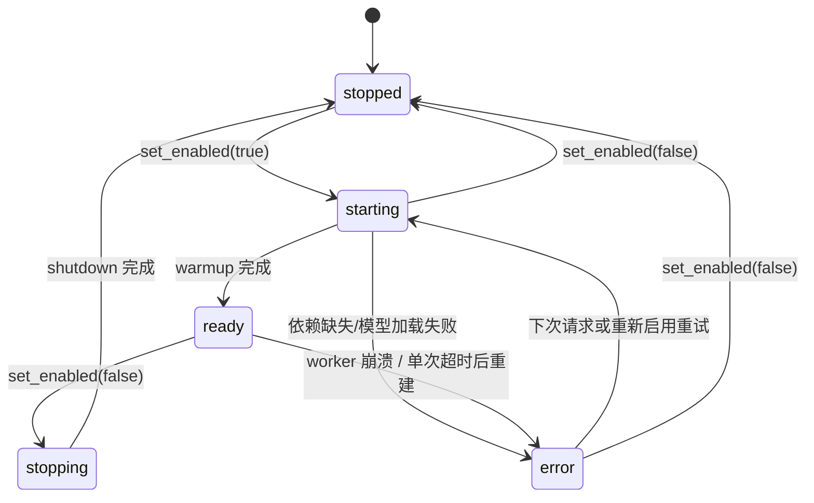

# Design: m4-local-ocr

## Context

当前路由只有云账号：`Scheduler` 从 `AccountRegistry` 取候选（`backend/app/core/registry.py:153-186`），没有账号即 `NoCandidate`；公共 API 的 `VALID_PROVIDERS` 只有 `auto/baidu/tencent`（`backend/app/api/public.py:28`）。运行时设置是 5 个标量键（`backend/app/runtime_settings.py:19-46`），热更新在 commit 后替换 `state.runtime`（`backend/app/api/admin.py:1075-1093`）。镜像用 `uv export --frozen` 安装依赖（`Dockerfile` 依赖层），因此新增 optional extra 必须同步锁文件。

本地引擎的外部事实（均实测）：rapidocr 3.10.0 wheel 内置 PP-OCRv6 small det/rec 与 PP-OCRv4 cls 模型，不联网；`RapidOCR()` 构造不加载模型，首次调用才加载；本机冷启动约 2.4s、热调用 0.49s（900×220）。动机见 `proposal.md`，决策全文见 `decision-memo.md`。

## Goals / Non-Goals

**Goals:**
- 本地引擎在独立进程内运行，事件循环不被 ONNX 推理阻塞；启停与就绪状态可查询、可观测。
- 兜底只在 `auto` 且本地真正可用时生效，且不挤占云端本可成功的预算。
- 记账与错误码语义在改动后仍与既有公共契约自洽（local 无账号、无厂商额度）。

**Non-Goals:**
- 不做模型下载、语言模型切换、GPU、批量本地识别（见 proposal Non-Goals）。
- 不改变云账号的候选/排序/冷却逻辑；`provider=baidu|tencent` 行为完全不变。
- 不引入多进程 worker 的负载均衡或跨实例协调（v1 单实例）。

## Decisions

本 change 的决策全文与砍掉的候选见 [`decision-memo.md`](./decision-memo.md)（D1–D16）；离线更新锁文件的操作决策见 [`ADR-0002`](../../adr/0002-offline-lock-update.md)。本文件只记录由这些决策推导出的技术形状与约束。

## 架构与组件

```
┌────────────────────────── 同一进程（uvicorn 单 worker） ──────────────────────────┐
│                                                                                  │
│  POST /v1/ocr/image                                                              │
│        │                                                                         │
│        ▼                                                                         │
│  public.py ── normalize_image(provider) ── cache ── semaphore                     │
│        │                                                                         │
│        ▼                                                                         │
│  Scheduler.recognize(provider, deadline)                                         │
│    ├─ provider=baidu|tencent ──▶ AccountRegistry 候选 ──▶ ProviderAdapter(HTTP)   │
│    ├─ provider=local ─────────▶ LocalEngine.recognize                            │
│    └─ provider=auto ──▶ 云尝试（截止 = deadline - reserve）                       │
│                          └─ 无候选/全失败 ──▶ LocalEngine.recognize              │
│                                                                                  │
│  LocalEngine（父进程，asyncio 单线程状态机）                                      │
│        │  run_in_executor + wait_for(timeout)                                    │
│        ▼                                                                         │
│  ProcessPoolExecutor(spawn, max_workers=local_ocr_max_concurrency)               │
│        └─ worker 进程：import rapidocr（懒加载模型），只收 bytes/语言             │
│                                                                                  │
│  admin.py ── /api/admin/settings（local_ocr_enabled）                            │
│           └─ /api/admin/local-ocr/status ──▶ LocalEngine.status()                │
└──────────────────────────────────────────────────────────────────────────────────┘
```

组件职责：
- `app/core/local_engine.py`（新）：父进程侧状态机、进程池、超时、计数与状态快照。
- `app/workers/local_ocr.py`（新）：worker 进程侧，模块级引擎缓存与 `run_ocr`/`warmup`；**不得**导入 `app.state`/`app.main`/配置，避免把凭证带进子进程；必须能被 spawn 单独导入。
- `app/core/scheduler.py`：增加 local 分支与 `auto` 兜底（云阶段截止 = 总 deadline − reserve）。
- `app/api/public.py`：`provider` 枚举、403/502/504 映射、`/v1/providers` 条目。
- `app/runtime_settings.py` / `config.py`：新设置键与环境默认。
- `app/utils/images.py`：local 分支的尺寸/字节上限。

## 请求路由与预算

`deadline` 仍是请求开始时的绝对 `time.monotonic()` 预算（R-SCH-03）。

| provider | 云阶段截止 | 兜底 | 说明 |
| --- | --- | --- | --- |
| `baidu` / `tencent` | `deadline` | 否 | 既有行为不变 |
| `local` | 不适用 | 不适用 | 直接本地；未启用/依赖缺失 → 403 |
| `auto` 且本地可用 | `deadline - reserve` | 是 | 云 `NoCandidate`/`UpstreamFailed`/`DeadlineExceeded` 时转本地 |
| `auto` 且本地不可用 | `deadline` | 否 | 不为不可用的 local 预留预算 |

本地单次超时 = `min(LOCAL_OCR_TIMEOUT_MS, deadline - now)`；剩余预算 < `LOCAL_OCR_MIN_BUDGET_MS`（默认 1000）时不再尝试本地，直接返回云阶段的原始错误（若显式 local 则 504）。

```
provider=auto?
   │否 ──▶ 云路径（不兜底）
   ▼是
本地 installed && enabled?
   │否 ──▶ 云路径（deadline 全额）
   ▼是
云尝试（deadline - reserve）
   │成功 ──▶ 返回云结果
   ▼失败/无候选
剩余 ≥ min_budget? ──否──▶ 返回云错误
   │是
本地识别（timeout = min(30s, 剩余)）
   │成功 ──▶ 返回 local 结果（quota_used=0）
   ▼失败
502 / 504
```

## 本地 worker 生命周期



规则：
- `set_enabled(true)` 只负责建池并提交 warmup（不阻塞 HTTP 响应），状态立刻为 `starting`。
- warmup 用 1×1 白图跑一次完整 pipeline，成功才算 `ready`（覆盖模型加载）。
- `starting` 期间的本地请求等待就绪事件，最多等 min(10s, 剩余预算)；超时按不可用处理。
- 单次超时：取消 future、`shutdown(wait=False, cancel_futures=True)` 重建池并回到 `starting`，本次返回 504；避免一个卡死任务永久占住唯一 worker。
- `BrokenProcessPool`：状态置 `error`，下次请求重建；错误写入 `last_error`。
- 关闭应用时 `await shutdown()`；不清空 `usage_event`。

## 并发与共享状态

- 状态只存在于事件循环线程：`LocalEngine` 的字段（state、计数器、last_*）无需锁；进程池回调通过 `run_in_executor` 回到事件循环。
- worker 进程之间不共享内存；并发由 `max_workers` 控制，默认 1，多请求在 executor 队列等待并各自受 deadline 约束。
- 全局 `MAX_CONCURRENT_REQUESTS` 信号量仍在最外层，本地请求也计入（不会因兜底绕过并发上限）。
- spawn 而非 fork：避免子进程继承父进程内存中的 `MASTER_KEY` 与已解密凭证。

## 数据模型与生命周期

新增运行时设置键（`settings` 表，key/value，无需 DDL）：

| 键 | 类型 | 默认 | 范围 |
| --- | --- | --- | --- |
| `local_ocr_enabled` | bool | `false` | — |

`usage_event.provider` 取值新增 `local`，仅有 check 约束变化（Alembic `0003`，batch 重建）：

| 对象 | v_old | v_new |
| --- | --- | --- |
| `ck_usage_provider` | `provider IN ('baidu','tencent','auto')` | `provider IN ('baidu','tencent','auto','local')` |
| `usage_events` 列 | 不变：`id, request_id, user_id, api_key_id, account_id, provider, capability, success, error_code, latency_ms, quota_used, cached, image_hash, created_at` | 同左（无增删列/类型/默认值变化） |
| `ck_accounts_provider` | `provider IN ('baidu','tencent')` | 不变（local 不建账号） |

downgrade：先 `UPDATE usage_events SET provider='auto' WHERE provider='local'`，再恢复旧约束；否则旧约束建立时必然失败。

## 失败模式与可观测性

| 场景 | 检测 | 系统行为 | 用户可见 | 恢复 |
| --- | --- | --- | --- | --- |
| 依赖未安装 | `find_spec` 失败 | `installed=false`，开关视为不可用 | 显式 local → 403；auto 不兜底 | 重装镜像 |
| 模型加载失败 | warmup 异常 | `state=error`，`last_error` | 显式 local → 502；auto 回云错误 | 重新启用触发重试 |
| worker 崩溃 | `BrokenProcessPool` | 重建池，`error→starting` | 本次 502 | 下次请求自动恢复 |
| 单次超时 | `asyncio.wait_for` | 重建池，取消排队任务 | 504 `TIMEOUT` | 下次请求自动恢复 |
| 队列排满 | executor 排队 + deadline | 等到 deadline 即超时 | 504 | 降低并发/扩大 worker |
| 云端失败且预算不足 | 剩余 < 1s | 不尝试本地，返回云错误 | 503/502/504（云错误） | 下次请求 |
| 开关在请求中变更 | 状态机 | 新请求按新状态；在跑任务跑完 | 可能一次 403/502 | 重试 |

可观测性：
- 结构化日志事件：`local_ocr.enabled` / `local_ocr.disabled` / `local_ocr.warmup`（含 model 与耗时）/ `local_ocr.fallback`（含 from_reason）/ `local_ocr.timeout` / `local_ocr.failed`。日志不含图片字节与识别原文。
- `usage_event`：`provider='local'`、`account_id=NULL`、`quota_used=0`、`latency_ms` 为整请求耗时；兜底成功与失败都记录。
- `GET /api/admin/local-ocr/status`：

```json
{
  "enabled": true,
  "installed": true,
  "state": "ready",
  "concurrency": 1,
  "timeout_ms": 30000,
  "reserve_ms": 5000,
  "model": {"engine": "onnxruntime", "family": "PP-OCRv6", "variant": "small", "bundled": true},
  "last_latency_ms": 812,
  "last_error": null,
  "requests_total": 12,
  "fallback_total": 3
}
```

- `GET /v1/providers` 增加：

```json
{"code": "local", "name": "本地 RapidOCR", "enabled": true}
```

- 设置更新示例：`PUT /api/admin/settings {"local_ocr_enabled": true}` → `{"settings": {...}, "cache_cleared": false}`；非法类型返回 400 且 `error.fields[].field="local_ocr_enabled"`。

## 非功能需求（数字化）

| 指标 | 目标 | 依据 |
| --- | --- | --- |
| 冷启动（建池→ready） | ≤5s | 本机实测 2.4s |
| 热调用 p95（≤2000px 截图） | ≤3s | 实测 900×220 为 0.49s；留 6× 余量 |
| 本地单次超时上限 | 30s，且不超过剩余总预算 | D4 |
| 本地预算预留 | 5s（auto 且本地可用时） | D4 |
| ready 等待上限 | min(10s, 剩余预算) | 冷启动 2.4s 的 4× 余量 |
| 镜像增量 | 下载 ≈110MB / 安装后 ≈350MB | 锁文件 wheel size 求和 |
| worker 常驻内存 | 200–300MB（估算） | 模型 32MB + onnxruntime/opencv 运行时 |

## 安全与数据保护

- 图片在进入进程池前已完成 Pillow 校验、EXIF 旋转与像素上限检查；worker 只收 JPEG/PNG 字节。
- worker 不读环境凭证、不连数据库、不发网络请求；`spawn` 避免继承父进程密钥。
- 识别原文与图片字节不落日志、不入状态接口；`usage_event` 只存 `image_hash` 前 16 位。
- 状态接口与设置接口沿用管理员会话 + CSRF；公共 `/v1/providers` 不泄露路径/版本细节。

## 切片与依赖

| 切片 | 交付行为 | 依赖 |
| --- | --- | --- |
| T1 引擎与进程池 | extra 可安装；worker 可 warmup/识别；父进程状态机与内部自检 | — |
| T2 公共路由与兜底 | `provider=local`、`auto` 兜底、预算预留、403/502/504 | T1 |
| T3 记账与迁移 | `usage_event` 接受 local；local 成功 quota_used=0 | T2（事件来源） |
| T4 管理端 | 设置项 + 状态接口 + 面板卡片 | T1 |
| T5 镜像与文档 | 镜像内置 extra、版本 0.3.0、README/.env.example | T1–T4 |

真实的 `Blocked-by` 以 `tickets.md` 为准，本表只表达语义依赖。

## Compliance

- **ADR-0001**：构建仍走 `uv export` + `uv pip install --index-url`，不读锁文件 URL；本 change 给 export 增加 `--extra local`。
- **ADR-0002**：锁文件用镜像重解析后把源 URL 规范化回 `pypi.org`/`files.pythonhosted.org`，并以 `uv lock --check --offline` 验证；不把镜像写进锁。
- **D-6（架构边界）**：只改 `usage_event.provider` 的取值域，不改变任何跨模块数据模型的结构；`settings` 仍是 key/value。
- **R-DEP-06/08**：不改单 worker 与非 root 约束；进程池子进程沿用容器用户。
- **凭证约定**：文档/注释不出现本机私有凭证文档的具体路径或文件名。
- **许可证**：PaddleOCR 模型 Apache-2.0；README 增加归属说明。

## Risks / Trade-offs

- **OpenCV 5 行为回归** → 已实测识别正确；若线上复现，pin `opencv-python-headless<5` 并重跑锁更新流程。
- **进程池在 Windows（spawn）与 Linux 行为差异** → worker 模块保持无副作用、只收原始类型；单测用 fake engine，真实引擎测试标 `slow`。
- **超时后重建池导致连续两次冷启动** → 只在超时/崩溃时重建；正常路径不重建。
- **锁 URL 规范化产出 404** → 只做 host 替换且核对路径后缀；`uv lock --check --offline` + `uv export` 双验证。
- **镜像体积增长** → 记录在 README；默认开关关闭，未启用时不占 CPU/内存。
- **`usage_events` batch 重建期间短暂锁表** → 迁移只在启动时执行，单实例；先备份 DB（R-DEP-05）。

## Migration Plan

1. 构建并发布 `0.3.0` 镜像（`latest` 同步；`0.2.1` 不动）。
2. 部署前 `sqlite3 .backup`；启动时自动执行 `0003`（放宽 check 约束）。
3. 管理端开启 `local_ocr_enabled`；观察 `local-ocr/status` 到 `ready`，再用 `provider=local` 验一张图。
4. **回滚顺序**：先关闭本地开关（避免新 local 事件）→ 停新容器 → 用 0.3.0 镜像执行 `alembic downgrade 0002`（local 行映射为 `auto`）→ 启动 `0.2.1`。不可先启旧镜像再降级：旧镜像的 Alembic 脚本目录不认识 `0003`。

## Open Questions

- 目标部署机（Linux 容器、2 核 4G 下限）的本地识别 p95 未实测；本机 Windows 数据为参考。verify 阶段在服务器上补测，不改变设计与票拆。
- 是否把 `opencv-python-headless` pin 到 `<5`：当前实测通过，暂不 pin；若出现回归再按锁更新流程收紧。
