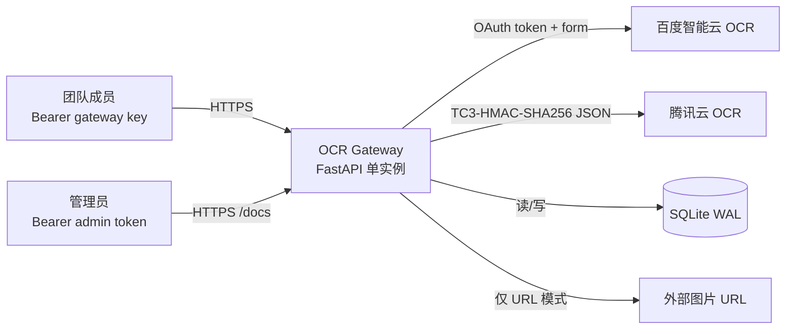
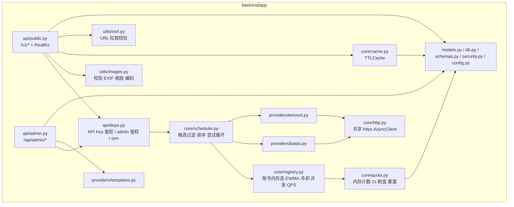
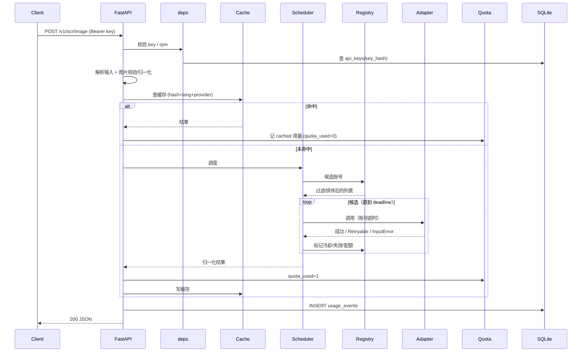
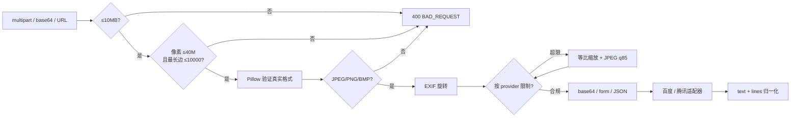
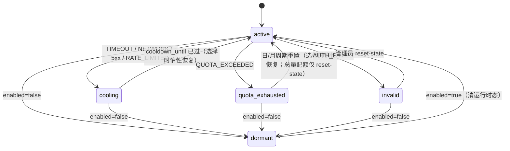

# Design

## Context

全新仓（`openspec/specs/` 为空），无既有代码与对外契约。动机见 [`proposal.md`](./proposal.md)；决策与砍掉的候选见 [`decision-memo.md`](./decision-memo.md)。

设计受以下已核实事实约束：

- 百度标准版：`POST https://aip.baidubce.com/rest/2.0/ocr/v1/general_basic`，`access_token` 走 query，`image` base64 后 urlencode，**base64+urlencode 后 ≤8MB**、最短边 ≥15px、最长边 ≤4096px，jpg/jpeg/png/bmp，`words_result` 默认不含 confidence。`[spec-review-amendment D10]`
- 腾讯 `GeneralBasicOCR`（Version `2018-11-19`，域名 `ocr.tencentcloudapi.com`，TC3-HMAC-SHA256），Base64 ≤10M，PNG/JPG/JPEG/BMP/PDF，`TextDetections[].Confidence` 可用。
- 部署为公网单实例 + 反代 HTTPS；规模 ≤5 人、日均 <500 次；真实凭证只存本地。

## Goals / Non-Goals

**Goals**：单进程可部署的 MVP；公共 OCR API（multipart/base64/URL）；管理 API（Bearer）；百度/腾讯适配器；账号池优先级/EWMA/切换；配额记账；内存缓存；可运行的 pytest 体系。

**Non-Goals（设计级边界，每条附可证伪假设）**：

- **多实例/多 worker**：`uvicorn` 固定单 worker。可证伪假设：日均 <500 次、≤5 人（D14），单进程事件循环足够；若峰值持续 >20 QPS 或需零停机，则内存计数/注册表方案失效，需改 Redis/Postgres。
- **任务队列/异步批处理**：无批量接口（proposal Non-Goals），请求全同步。可证伪假设：单张图片处理 p99 不超过请求 deadline（20s）；若厂商延迟常态超过 deadline，则需异步任务模型。
- **前端 SPA**：管理操作走 `/docs`/curl。可证伪假设：运营动作集合为 JSON CRUD（`docs/tech-selection.md:325-349`），无需浏览器专用交互；若出现必须可视化的操作（如图表筛选），再回补面板。
- **本地 OCR**：无进程池。可证伪假设：MVP 期间至少一家云厂商可用；若两家同时不可用，`auto` 返回 `PROVIDER_UNAVAILABLE`（503）。
- **PDF/批量/结构化**：仅单张图片。可证伪假设：MVP 客户端只需图片 OCR；若出现 PDF 需求，另开 change（`docs/tech-selection.md:653`）。
- **多租户/成员登录**：成员只是配额归属。可证伪假设：成员用 Key 调 API 即可自助查询用量（`/v1/me`）。

## 架构与组件

### C4 Context



### Container / Component



### 组件清单

| 组件 | 职责 | 明确不做 |
| --- | --- | --- |
| `api/public.py` | `/v1/ocr/image`、`/v1/providers`、`/v1/me`、`/healthz` | 不直接调厂商 |
| `api/admin.py` | 登录、成员、Key、账号、用量、日志、测活、重置、清缓存 | 不返回凭证明文 |
| `api/deps.py` | Key 校验、admin 鉴权、每 Key RPM | 不做 IP 匿名限流（MVP 无匿名） |
| `core/scheduler.py` | 过滤、排序、deadline 尝试循环、结果/错误归一 | 不落盘、不重试输入错误 |
| `core/registry.py` | 账号内存态、EWMA、冷却、并发计数、QPS 令牌桶 | 不持久化运行时状态 |
| `core/quota.py` | 账号配额计数、周期键、2s 批量 upsert、启动加载 | 不做用户级配额表 |
| `core/cache.py` | `sha256(image)+language+provider` → 结果 | 不缓存空文本/超 256KB |
| `providers/baidu.py` | OAuth token 缓存、`general_basic` 调用、错误映射 | 不做多能力路由 |
| `providers/tencent.py` | TC3 签名、`GeneralBasicOCR`、错误映射 | 不做多能力路由 |
| `providers/templates.py` | 内置厂商配额参考值与凭证字段 schema，标注「以官网为准」 | 不做自动套用、不落库 |
| `utils/images.py` | 真实格式校验、EXIF 旋转、按厂商限制缩放/编码 | 不做版面/坐标处理 |
| `utils/ssrf.py` | URL scheme/主机/IP/重定向/大小/超时校验 | 不代理非图片内容 |
| `core/http.py` | 连接池、默认超时、keep-alive | 不做业务重试 |
| `security.py` | AES-GCM 凭证、Key 哈希、admin token、常量时间比较 | 不做密钥轮换 |

### 公共请求序列



### 图片数据流



`provider=auto` 时按最严限制（百度：base64+urlencode 后 ≤8MB、最短边 ≥15px、最长边 ≤4096px）归一化，保证任一候选都能发；显式 `provider` 时按该厂商限制（腾讯 10MB）。解码前用 `Image.open()` 读取尺寸，超过 40M 像素或最长边 >10000 直接 400，并显式设置 `PIL.MAX_IMAGE_PIXELS`。`[spec-review-amendment D8/D10]`

## 数据模型与生命周期

### 表结构

所有时间戳存 UTC（SQLite 以 ISO-8601 文本存），展示/重置按 `Asia/Shanghai` 计算。

#### `users`

| 列 | 类型 | 约束 | 默认 | Nullable |
| --- | --- | --- | --- | --- |
| `id` | INTEGER | PK AUTOINCREMENT | — | 否 |
| `name` | TEXT | UNIQUE | — | 否 |
| `enabled` | BOOLEAN | — | 1 | 否 |
| `created_at` | DATETIME | — | — | 否 |

> 管理员不是 DB 行：由 `ADMIN_PASSWORD` 环境变量提供（见 decision-memo D4）；`users` 仅成员（配额归属）。

#### `api_keys`

| 列 | 类型 | 约束 | 默认 | Nullable |
| --- | --- | --- | --- | --- |
| `id` | INTEGER | PK AUTOINCREMENT | — | 否 |
| `user_id` | INTEGER | FK `users.id` ON DELETE CASCADE | — | 否 |
| `name` | TEXT | — | — | 否 |
| `key_prefix` | TEXT | — | — | 否 |
| `key_hash` | TEXT | UNIQUE | — | 否 |
| `enabled` | BOOLEAN | — | 1 | 否 |
| `daily_limit` | INTEGER | ≥0 | NULL | 是 |
| `rpm_limit` | INTEGER | ≥0 | NULL | 是 |
| `last_used_at` | DATETIME | — | NULL | 是 |
| `created_at` | DATETIME | — | — | 否 |

#### `accounts`

| 列 | 类型 | 约束 | 默认 | Nullable |
| --- | --- | --- | --- | --- |
| `id` | INTEGER | PK AUTOINCREMENT | — | 否 |
| `provider` | TEXT | CHECK IN (`baidu`,`tencent`) | — | 否 |
| `name` | TEXT | — | — | 否 |
| `owner_id` | INTEGER | FK `users.id` ON DELETE SET NULL | NULL | 是 |
| `credentials_enc` | TEXT | AES-GCM 密文（nonce‖ct‖tag，Base64） | — | 否 |
| `priority` | INTEGER | — | 100 | 否 |
| `weight` | INTEGER | ≥1 | 1 | 否 |
| `enabled` | BOOLEAN | — | 1 | 否 |
| `timeout_ms` | INTEGER | >0 | 8000 | 否 |
| `max_concurrency` | INTEGER | ≥1 | 2 | 否 |
| `qps_limit` | REAL | >0 | NULL | 是 |
| `quota_daily` | INTEGER | ≥0 | NULL | 是 |
| `quota_monthly` | INTEGER | ≥0 | NULL | 是 |
| `quota_total` | INTEGER | ≥0 | NULL | 是 |
| `quota_unit` | TEXT | CHECK IN (`image`) | `image` | 否 |
| `reset_day` | INTEGER | 1–28 | 1 | 否 |
| `state` | TEXT | CHECK IN (`active`,`cooling`,`invalid`,`quota_exhausted`) | `active` | 否 |
| `cooldown_until` | DATETIME | — | NULL | 是 |
| `last_error_code` | TEXT | — | NULL | 是 |
| `last_error_message` | TEXT | 截断 500 字符 | NULL | 是 |
| `ewma_latency_ms` | REAL | ≥0 | 1000 | 否 |
| `last_used_at` | DATETIME | — | NULL | 是 |
| `created_at` | DATETIME | — | — | 否 |
| `updated_at` | DATETIME | — | — | 否 |

> `state` 只存运行时态；管理员禁用用 `enabled=false` 表达，API 展示时合并为 `disabled`（避免双真相）。

#### `usage_events`

| 列 | 类型 | 约束 | 默认 | Nullable |
| --- | --- | --- | --- | --- |
| `id` | INTEGER | PK AUTOINCREMENT | — | 否 |
| `request_id` | TEXT | UNIQUE | — | 否 |
| `user_id` | INTEGER | FK `users.id` ON DELETE SET NULL | NULL | 是 |
| `api_key_id` | INTEGER | FK `api_keys.id` ON DELETE SET NULL | NULL | 是 |
| `account_id` | INTEGER | FK `accounts.id` ON DELETE SET NULL | NULL | 是 |
| `provider` | TEXT | CHECK IN (`baidu`,`tencent`) | — | 否 |
| `capability` | TEXT | — | `general_text` | 否 |
| `success` | BOOLEAN | — | — | 否 |
| `error_code` | TEXT | — | NULL | 是 |
| `latency_ms` | INTEGER | ≥0 | — | 否 |
| `quota_used` | INTEGER | ≥0 | 0 | 否 |
| `cached` | BOOLEAN | — | 0 | 否 |
| `image_hash` | TEXT | 16 hex | NULL | 是 |
| `created_at` | DATETIME | — | — | 否 |

#### `quota_counters`

| 列 | 类型 | 约束 | 默认 | Nullable |
| --- | --- | --- | --- | --- |
| `account_id` | INTEGER | FK `accounts.id` ON DELETE CASCADE | — | 否 |
| `period_type` | TEXT | CHECK IN (`daily`,`monthly`,`total`) | — | 否 |
| `period_key` | TEXT | 日：`YYYY-MM-DD`；月：周期起始日 `YYYY-MM-DD`；总量：`all` | — | 否 |
| `used` | INTEGER | ≥0 | 0 | 否 |
| `updated_at` | DATETIME | — | — | 否 |

主键：`(account_id, period_type, period_key)`。

> 月周期起始日 = 最近一个 `reset_day`（`reset_day=1` 时即当月 1 日）；`quota_total` 没有周期，耗尽后仅管理员 `reset-state` 恢复。`[spec-review-amendment D2]`

索引：

- `api_keys.key_hash` UNIQUE；`api_keys.user_id`。
- `accounts.provider`；`accounts.enabled, state`。
- `usage_events.request_id` UNIQUE；`usage_events.created_at`；`usage_events.api_key_id, created_at`。
- `quota_counters` 主键即查询键。

### 账号状态机



> 图中 `dormant` 是 `enabled=false` 的展示态，不写入 `accounts.state`。

### 生命周期

- **创建**：管理员建账号 → 凭证加密入库 → 注册内存态（`ewma` 用厂商种子值，百度/腾讯各 1000ms）→ 状态 `active`。
- **使用**：成功更新 `ewma`、`last_used_at`、内存配额计数；失败按状态机转移并记 `last_error_*`。
- **重置**：日配额 `Asia/Shanghai` 00:00；月配额 `reset_day` 当天 00:00（默认 1），周期键取该周期起始日 `YYYY-MM-DD`；`quota_total` 不自动重置；进程启动时按周期键从 `quota_counters` 加载。`[spec-review-amendment D2]`
- **删除**：账号删除级联删计数；`usage_events.account_id` SET NULL，历史保留。
- **配额模板**：`providers/templates.py` 内置只读参考值（百度/腾讯 + 凭证字段），不落库、不自动套用；账号配额仍由管理员创建时填写。

### 迁移 v_old / v_new

`v_old`：空（全新库，无存量 schema）。`v_new`：上表全部列已列在「表结构」；Alembic 初始 revision 一次性建表、索引与外键，`downgrade()` 删表。无数据回填。

## 调度与失败语义

### 候选过滤

1. `provider` 匹配（显式时只取该厂商；`auto` 取全部）。
2. `enabled = true`。
3. 惰性恢复：`cooling` 且 `cooldown_until <= now` → `active`；`quota_exhausted` 且当前周期键变化 → `active`。
4. `state = active`。
5. 当前周期配额未达上限（内存计数；`NULL` 视为不限）。
6. `in_flight < max_concurrency`。
7. `qps_limit` 令牌桶有令牌（`NULL` 视为不限）。

### 排序

`(priority ASC, ewma_latency_ms / weight ASC, last_used_at ASC NULLS FIRST)`；成功请求 `ewma = 0.2*latency + 0.8*ewma`，只统计成功；超时不污染均值（通过冷却惩罚）。

### 尝试循环

```text
deadline = now + request_deadline_ms
had_candidate = False
last_error = None
deadline_exhausted = False
for account in candidates:
    had_candidate = True
    remaining = deadline - now
    if remaining <= 0:
        deadline_exhausted = True
        break
    timeout = min(account.timeout_ms, remaining)
    try:
        return await adapter.call(account, timeout)
    except Retryable as e:
        last_error = e
        registry.mark(account, e)   # 冷却/失效/配额
        continue
    except InputError:
        raise                       # 不换账号
if not had_candidate:
    raise PROVIDER_UNAVAILABLE      # 503：没有可用账号
if deadline_exhausted:
    raise TIMEOUT                   # 504：有候选，预算耗尽
if last_error is not None and last_error.kind == PROVIDER_ERROR:
    raise PROVIDER_ERROR            # 502：候选都在，但厂商异常
raise PROVIDER_UNAVAILABLE          # 503：候选均不可用（鉴权/配额/冷却）
```

> 503/504/502 的区分固定为：无候选 → 503；有候选且预算耗尽 → 504；有候选、预算未耗尽、最后一次失败为 `PROVIDER_ERROR` → 502。`[spec-review-amendment D1/D5]`

### 失败分类与冷却

| 分类 | 触发 | 账号状态 | 网关响应 |
| --- | --- | --- | --- |
| `AUTH_FAILED` | 401/403 / 厂商鉴权错误码（百度 110/111 先刷新 token 重试一次；腾讯 `SignatureExpire` 见 Q4） | `invalid`（不自动恢复） | 继续下一个候选；全无 → 503 |
| `QUOTA_EXCEEDED` | 厂商配额错误码 / 余额不足 | `quota_exhausted`（日/月周期重置恢复；总量仅 reset-state） | 同上 |
| `RATE_LIMITED` | HTTP 429 / 厂商限流错误码 | `cooling` 30s（`Retry-After` 上限 300s） | 同上 |
| `TIMEOUT` / 网络 | 连接/读取超时、DNS/连接错误 | `cooling` 30s | 同上 |
| `PROVIDER_ERROR` | 5xx / 协议错误 / 非法 JSON | `cooling` 10s | 同上 |
| 输入错误 | 厂商返回参数/格式错误 | 不变 | 400 `BAD_REQUEST`，不切换 |
| 空文本 | 厂商成功但 `text=""` | 不变 | 成功 + `warnings: ["EMPTY_TEXT"]` |

> 厂商错误码到分类的映射固定在 `providers/*.py` 的映射表内，并各有一组黄金用例；映射表依据官方错误码文档维护，完整表见文末附录（含官方 URL 与核对日期）。`[spec-review-amendment D31]`
>
> 全部候选失败时的对外状态：最后一次失败为 `PROVIDER_ERROR` → 502；否则 503；预算耗尽 → 504。`[spec-review-amendment D1/D5]`

### 并发与共享状态

- `uvicorn` **单 worker**；所有内存态（注册表、配额计数、令牌桶、缓存）都只在单一 asyncio 事件循环内读写，无需锁。
- 每账号 `in_flight` 为整数计数（进入候选前自增、`finally` 自减），替代 `Semaphore` 的非阻塞探测。
- 每账号 QPS 令牌桶按 `monotonic()` 惰性补充；`auto` 请求跨厂商时按各自桶独立判断。
- 每个**进入调度**的请求 `INSERT` `usage_events` 并 `commit`（鉴权/输入校验失败的请求只记 stdout，`provider` 保持 NOT NULL）；账号配额计数用内存值，后台任务每 2s 整行 upsert，`shutdown` 时再刷一次；账号状态/EWMA/`last_used_at` 随请求提交（每请求一次 UPDATE）。`[spec-review-amendment D3/D14]`
- SQLite 启动时 `PRAGMA journal_mode=WAL; PRAGMA synchronous=NORMAL;`；`usage_events` 的每请求 commit 计入 p99 预算。`[spec-review-amendment D30]`
- 配额检查在选中账号时做、成功时递增；并发下允许 ≤`max_concurrency-1` 的瞬时超额，厂商侧配额错误兜底。`[spec-review-amendment D28]`
- 共享 `httpx.AsyncClient`（`max_connections=100`、`max_keepalive_connections=20`、默认 `connect=3s/read=account.timeout`）。
- 禁止多 worker/多实例的约束写入 README 与启动日志；启动时检测 `WEB_CONCURRENCY`、`UVICORN_WORKERS` 与 `sys.argv` 中的 `--workers`，任一 >1 直接拒绝启动（fail-loud）。`[spec-review-amendment D17]`

## API 合约

### 公共 API

除 `/healthz` 外统一认证：`Authorization: Bearer ocr_...`；`/healthz` 不鉴权（供反代/uptime 探活）。`[spec-review-amendment D19]` 错误响应：

```json
{
  "request_id": "550e8400-e29b-41d4-a716-446655440000",
  "error": { "code": "UNAUTHORIZED", "message": "invalid api key" }
}
```

#### `POST /v1/ocr/image`

multipart 请求（`file` 必填，`image_base64` 可选但不得与 `file` 同现，`language` 默认 `zh`，`provider` 默认 `auto`）；JSON 请求二选一：`[spec-review-amendment D15]`

```json
{ "image_base64": "iVBORw0...", "mime_type": "image/png", "language": "zh", "provider": "auto" }
```

```json
{ "image_url": "https://example.com/a.png", "language": "zh", "provider": "auto" }
```

`language` 只接受 `zh`（默认）/`en`/`auto`，其它值 400；映射：`zh` → 百度 `language_type=CHN_ENG`、腾讯 `LanguageType=zh`；`en` → 百度 `ENG`、腾讯 `en`；`auto` → 百度 `CHN_ENG`（尽力）、腾讯 `auto`。`[spec-review-amendment D4]`

成功响应（`200`）：

```json
{
  "request_id": "550e8400-e29b-41d4-a716-446655440000",
  "provider": "baidu",
  "text": "第一行\n第二行",
  "lines": [{ "text": "第一行", "confidence": null }, { "text": "第二行", "confidence": null }],
  "latency_ms": 412,
  "cached": false,
  "quota": { "unit": "image", "used": 1 },
  "warnings": []
}
```

`provider` 取值：`auto`、`baidu`、`tencent`（`local` 不在 MVP，传入返回 `400 BAD_REQUEST`）。显式厂商不跨厂商回退；`auto` 才可跨账号/厂商切换。`POST /v1/ocr/image` 无幂等键：客户端超时重试会再次调用厂商并重复扣配额（缓存仅在首次成功写入后生效）。`[spec-review-amendment D28]`

#### 其余

- `GET /v1/providers` → `{"providers":[{"code":"baidu","name":"百度智能云","available_accounts":2,"enabled":true}, ...]}`；不泄露凭证。
- `GET /v1/me` → `{"user":"小明","key_prefix":"ocr_ab12","today":{"requests":42,"quota_used":42},"limits":{"daily_limit":200,"rpm_limit":30}}`。`today.requests` = 当日进入调度的请求数（含缓存命中）；`today.quota_used` = 当日 `quota_used` 合计；`daily_limit` 的计数口径待 Q2 拍板（推荐按 `quota_used` 比较）。`[spec-review-amendment Q2]`
- `GET /healthz` → `{"status":"ok","db":"ok","version":"0.1.0"}`；DB `SELECT 1` 1s 超时失败 → `503`。

### 管理 API

`POST /api/admin/login`：`{"password":"..."}` → `{"token":"<signed>","expires_in":43200}`；后续 `Authorization: Bearer <token>`。无 cookie、无 CSRF；无服务端 logout（客户端丢弃 token，12h 过期）。登录失败按 IP + 全局双层限速（5 次/分钟）；全局层只增加延迟、不永久阻断，避免攻击者用错误密码把管理员锁在门外。`[spec-review-amendment D16]`

| 方法 | 路径 | 请求要点 | 响应要点 |
| --- | --- | --- | --- |
| GET | `/api/admin/me` | — | `{"username":"admin"}` |
| GET/POST | `/api/admin/users` | `{"name"}` | 列表 / 新建 |
| PATCH/DELETE | `/api/admin/users/{id}` | `{"name?","enabled?"}` | 更新 / 204 |
| GET/POST | `/api/admin/api-keys` | `{"user_id","name","daily_limit?","rpm_limit?"}` | 新建时仅此一次返回明文 `key` |
| PATCH/DELETE | `/api/admin/api-keys/{id}` | `{"enabled?","daily_limit?","rpm_limit?"}` | 更新 / 204 |
| GET/POST | `/api/admin/accounts` | 见下方凭证 schema | 列表（凭证脱敏）/ 新建 |
| PATCH/DELETE | `/api/admin/accounts/{id}` | 可改配额/优先级/并发/凭证（重传则重加密） | 更新 / 204 |
| POST | `/api/admin/accounts/{id}/test` | multipart 可选 `file`；缺省用内置样图 | `{"ok":true,"text":"...","latency_ms":350,"provider":"baidu"}` |
| POST | `/api/admin/accounts/{id}/reset-state` | — | `{"state":"active"}` |
| GET | `/api/admin/usage/summary` | `from`、`to`（ISO-8601，按 `Asia/Shanghai` 解释，默认最近 7 天）、`group_by=user\|provider\|account` | 聚合行 |
| GET | `/api/admin/logs` | `limit`(默认50,≤200)、`offset`、`success`、`provider` | 事件列表（无原文） |
| GET | `/api/admin/quota-templates` | — | 百度/腾讯参考额度与凭证字段，标注「以官网为准」 |
| POST | `/api/admin/cache/clear` | — | `{"cleared":123}` |

凭证 schema（创建/更新账号）：

```json
{ "provider": "baidu", "name": "百度-小明", "owner_id": 1, "priority": 100,
  "credentials": { "app_id": "123456", "api_key": "AK...", "secret_key": "SK..." } }
```

```json
{ "provider": "tencent", "name": "腾讯-小红", "owner_id": 1, "priority": 100,
  "credentials": { "secret_id": "AKID...", "secret_key": "..." } }
```

响应只回 `credential_fields` 名称与脱敏前缀，MUST NOT 回明文。

> 腾讯 `Region` 为可选参数，MVP 不传；如厂商要求，后续加列并定义。`[spec-review-amendment D21]`

## 缓存

- Key：`sha256(image_bytes)` + `language` + (`provider` 或 `auto`)。
- 存储：进程内 `cachetools.TTLCache`（LRU + TTL），1000 条 / 3600s（环境变量可调）；单条结果 >256KB 或 `text=""` 不缓存。最坏内存 1000×256KB≈256MB；实际 OCR 结果通常 <10KB。`[spec-review-amendment D30]`
- 命中：`cached=true`、`quota_used=0`、不调厂商；`provider` 回原结果厂商；`latency_ms` 为本次网关耗时。
- 仅缓存成功结果；URL 拉取的中间响应不缓存，只缓存最终 OCR 结果。

## 配置（环境变量）

| 变量 | 必填 | 默认 | 说明 |
| --- | --- | --- | --- |
| `MASTER_KEY` | 是 | — | 32 字节 Base64/hex；缺失/长度错 → 启动失败 |
| `ADMIN_PASSWORD` | 是 | — | ≥8 字符；缺失 → 启动失败 |
| `DATA_DIR` | 否 | `./data` | SQLite 与日志目录 |
| `DATABASE_URL` | 否 | `sqlite+aiosqlite:///<DATA_DIR>/ocr-gateway.db` | |
| `DEFAULT_TIMEOUT_MS` | 否 | `8000` | 账号默认超时 |
| `REQUEST_DEADLINE_MS` | 否 | `20000` | 单请求总预算 |
| `CACHE_ENABLED` | 否 | `true` | |
| `CACHE_TTL_SECONDS` | 否 | `3600` | |
| `CACHE_MAX_ENTRIES` | 否 | `1000` | |
| `MAX_UPLOAD_BYTES` | 否 | `10485760` | 解码后的图片字节数上限（multipart 与 base64 JSON 一致）`[spec-review-amendment D11]` |
| `MAX_IMAGE_PIXELS` | 否 | `40000000` | 解码前像素上限，超限 400 `[spec-review-amendment D8]` |
| `URL_FETCH_TIMEOUT_SECONDS` | 否 | `10` | |
| `URL_FETCH_MAX_BYTES` | 否 | `10485760` | |
| `SESSION_TTL_SECONDS` | 否 | `43200` | admin token 有效期 |
| `LOG_LEVEL` | 否 | `INFO` | |

> `settings` 表不在 MVP（D5）；改配置需重启。

## 可观测性与失败模式

### 失败模式表

| 依赖/环节 | 超时 | 失败行为 | 回滚/恢复 |
| --- | --- | --- | --- |
| 百度 OAuth token | ≤min(2s, 剩余预算)，1 次重试，总 ≤4s | 先解析 body 的 `error`/`error_description`（HTTP 200 也可能是错误）；401/403/110/111 → 刷新后重试一次，仍失败 → `invalid`；网络/5xx → `cooling` 30s | 无写操作；下次请求重新取 token |
| 百度 `general_basic` | `account.timeout_ms`（≤deadline） | 按失败分类表处理 | 无写操作；切候选 |
| 腾讯 `GeneralBasicOCR` | `account.timeout_ms`（≤deadline） | 按失败分类表处理 | 无写操作；切候选 |
| 外部图片 URL | 10s，≤3 重定向 | 400 `BAD_REQUEST`（不回显内网细节） | 无写操作 |
| SQLite | 本地，连接 5s | 启动失败即拒绝启动；运行期 `usage_events` 写失败 → 500 `INTERNAL_ERROR`（厂商已消耗，内存计数保持 +1，并记录写失败日志） | 配额刷盘失败保留内存值，下个 2s 周期重试 |
| 缓存 | 进程内 | 异常时跳过缓存，不影响请求 | 重启即清空 |
| admin token | 签名校验（无外部调用） | 过期/无效 → 401 | 重新登录 |

### 日志与健康检查

- stdout 结构化 JSON：`ts`、`level`、`event`、`request_id`、`method`、`path`、`status`、`latency_ms`、`provider`、`account_id`、`cached`、`error_code`。
- MUST NOT 记录：API Key 明文、凭证、OCR 原文、图片字节；`image_hash` 只存前 16 位。
- `httpx` logger 设为 WARNING（或加 URL query 脱敏过滤器），避免 INFO 日志记录含百度 `access_token` 的完整 URL。`[spec-review-amendment D9]`
- 管理端测活与错误信息截断 500 字符。
- `/healthz` 只检查 DB；进程存活由 uvicorn 决定。
- 无 Prometheus `/metrics`（proposal Non-Goals）。

## 非功能需求（数字化）

| 指标 | 目标 | 度量 |
| --- | --- | --- |
| 网关自身开销 | mock 厂商 0ms 时 p99 <20ms（不含厂商） | pytest 基准脚本 |
| 单请求总预算 | 默认 20s；账号默认 8s | 集成测试注入延迟 |
| 峰值吞吐 | ≤5 QPS；均值 <0.01 QPS（500/日） | 日志统计 |
| 上传上限 | 10MB（解码后）；百度目标 base64+urlencode 后 ≤8MB、最短边 ≥15px、长边 ≤4096px | 边界测试 |
| 缓存 | 1000 条 / 1h / 单条 ≤256KB（最坏 ≈256MB） | 单测 |
| 配额刷盘 | 每 2s；崩溃最多丢 2s 计数 | 单测 + 故障注入 |
| 启动 | <5s（无模型下载） | 计时 |
| 数据增长 | ≈500 行/日 → ≈18 万行/年 | SQL 统计 |
| 可用性 | 单实例，无 SLA 承诺；维护窗口重启 | README 声明 |
| 备份 | 每日 `sqlite3 .backup` 到 `data/backup/`（保留 7 天，运维脚本/文档）`[spec-review-amendment D29]` | 恢复演练 |
| RPO / RTO | 配额计数 RPO ≤2s；账户/Key 配置 RPO = 上次备份；RTO = 重启（<5s）`[spec-review-amendment D29]` | 文档声明 |

## 安全与数据保护

- **威胁模型**：公网 API Key 泄露/滥用、凭证盗取、SSRF 探测内网、管理员口令爆破、日志泄露。
- **凭证**：AES-256-GCM（12B nonce + 16B tag，AAD=`account-credentials`），Base64 存 `credentials_enc`；`MASTER_KEY` 启动校验；无轮换（MVP，文档标注）。
- **API Key**：`ocr_` + 32 随机字节（URL-safe）；库中只存 SHA-256；面板/API 只回前缀；明文只在创建响应出现一次。
- **管理员**：`ADMIN_PASSWORD` 常量时间比较；签名 token（`itsdangerous`，签名密钥由 `MASTER_KEY` 经 HKDF-SHA256 派生，info=`admin-session`，TTL 12h）；登录按 IP + 全局双层限速 5 次/分钟（全局层只延迟不阻断）。`[spec-review-amendment D16]`
- **SSRF**：仅 `http/https`；拒绝 URL 内嵌凭证；`socket.getaddrinfo` 解析全部 A/AAAA，拒私网/回环/链路本地/组播/保留/云元数据 `169.254.169.254`；每一跳重定向重新校验；≤3 跳；10s/10MB；`Pillow` 二次校验内容。残余风险：DNS rebinding（已接受，见 decision-memo 边角）。
- **输入**：10MB（解码后图片字节）上限；`Image.open()` 先读尺寸，>40M 像素或最长边 >10000 → 400；显式设置 `PIL.MAX_IMAGE_PIXELS`；`Pillow.verify()` + 实际解码；仅 JPEG/PNG/BMP；EXIF 旋转后再编码。`[spec-review-amendment D8/D11]`
- **传输**：应用不终结 TLS，绑定内网/回环，由反代终结 HTTPS；应用不信任 `X-Forwarded-*` 做安全判断。
- **数据最小化**：不存 OCR 原文；`image_hash` 前 16 位；错误信息截断；日志脱敏。
- **CSRF**：无 cookie 会话 ⇒ 不适用；若未来恢复 cookie 面板，必须同时恢复 CSRF 双提交。

## Decisions

本 change 的决策全文与砍掉的候选见 [`decision-memo.md`](./decision-memo.md)。

## 切片与依赖

真实 `Blocked-by` 在出票时写入 `tickets.md`；本节是语义源。

| 切片 | 交付的可观察行为 | 依赖 |
| --- | --- | --- |
| S1 脚手架与存储 | `uv run pytest` 绿；`/healthz` 200；Alembic 初始迁移可升降级 | 无 |
| S2 管理端鉴权与实体 | `/docs` 登录；创建成员/Key/账号；凭证加密落库；Key 明文仅一次 | S1 |
| S3 百度链路 | multipart/base64 调 `/v1/ocr/image` 经百度返回归一化结果；记账 +1；失败不扣配额 | S1, S2 |
| S4 腾讯链路与切换 | 腾讯适配器可用；同厂商多账号 5xx/超时自动切换；显式厂商不回退 | S3 |
| S5 输入补全与可运营性 | URL 输入（SSRF 防护）、缓存命中、`/v1/providers`、`/v1/me`、用量/日志、账号测活/重置 | S3, S4 |

五张垂直切片，落在 3–6 张预算内；每张都能独立验证。

## Risks / Trade-offs

- [签名手写易错] → 腾讯 TC3/百度 token 各配官方示例黄金用例 + 真实 key 契约验收（默认 skip）。
- [免费额度数值过时] → 模板可编辑、标「以官网为准」、上线前核对。
- [共享账号池触发风控] → 账号级并发/QPS + Key RPM/日限额 + 不对外转售。
- [单 worker 约束被绕过] → 启动检测 `WEB_CONCURRENCY` 告警 + README 显式声明。
- [SQLite 写放大] → 每请求仅 1 条 usage 事件；配额计数批量 upsert。
- [DNS rebinding 残余] → 解析后校验 + 逐跳复核；MVP 接受，后续可加 IP 固定/代理出口。
- [管理员 token 无法即时吊销] → 12h TTL；改密码后旧 token 仍有效（已接受，文档标注）。
- [登录限速反被用来锁死管理员] → 按 IP + 全局双层，全局层只延迟不阻断（D16）。
- [大图解码 OOM] → 像素上限 + `PIL.MAX_IMAGE_PIXELS`（D8）；全局并发上限见 Q5。
- [百度 token 落日志] → `httpx` logger WARNING/URL 脱敏（D9）。

## Migration Plan

**部署**：`uv sync` → 设置 `MASTER_KEY`/`ADMIN_PASSWORD` → `uv run alembic upgrade head` → `uv run uvicorn app.main:app --host 127.0.0.1 --port 8000`（单 worker）→ 反代 HTTPS。健康检查 `/healthz`。

**回滚**：`alembic downgrade base`（删表）或直接停止进程并移除 `data/`（greenfield，无历史数据）；回滚不涉及外部系统。

## Compliance

- 遵守 `docs/tech-selection.md` 的接口/错误码/安全设计；偏离项 D1（厂商范围 4→2）、D3（批量/本地 OCR 延后）、D4（Bearer 管理鉴权）、D5（无 settings 表）、D10（无匿名模式）、无 Docker/Compose（proposal Non-Goals，技术选型 M5）已在 decision-memo/Non-Goals 记录，无沉默例外。`[spec-review-amendment D18]`
- 账号禁用以 `enabled=false` 表达，`state` 只存运行时态（API 展示合并为 `disabled`）；`quota_unit` MVP 仅支持 `image`。
- 遵守 sdflow-spec-driven 格式：Requirement + `#### Scenario`、tasks 双向追溯。
- 本 change 不涉及跨产品/跨模块共享数据模型（D-6 不适用：单项目、单库）。
- 真实凭证只存本地，MUST NOT 出现在本设计、spec、tasks、测试夹具或日志中。
- 兼容性：无既有消费者；不承诺向后兼容。

## 附录：厂商错误码映射

> `[spec-review-amendment D31]` 核对日期 2026-11-03。官方文档：百度 <https://cloud.baidu.com/doc/OCR/s/dk3h7y5vr>；腾讯 <https://cloud.tencent.com/document/api/866/33528>。

| 厂商 | 码 | 分类 |
| --- | --- | --- |
| 百度 | 110 / 111 | `AUTH_FAILED`（先刷新 token 重试一次，仍失败才 invalid） |
| 百度 | 17 / 19 / 216604 | `QUOTA_EXCEEDED` |
| 百度 | 18 / 4 | `RATE_LIMITED` |
| 百度 | 100 / 216201 | `InputError` |
| 百度 | 其他 `error_code` | `PROVIDER_ERROR` |
| 腾讯 | `AuthFailure.SignatureFailure` / `AuthFailure.SecretIdNotFound` | `AUTH_FAILED` |
| 腾讯 | `AuthFailure.SignatureExpire` | `PROVIDER_ERROR`（时钟/配置问题；Q4 待拍板） |
| 腾讯 | `ResourceUnavailable.InArrears` | `QUOTA_EXCEEDED` |
| 腾讯 | `RequestLimitExceeded` | `RATE_LIMITED` |
| 腾讯 | `FailedOperation.ImageDecodeFailed` / `InvalidParameterValue` | `InputError` |
| 腾讯 | `InternalError` / 其他 | `PROVIDER_ERROR` |
